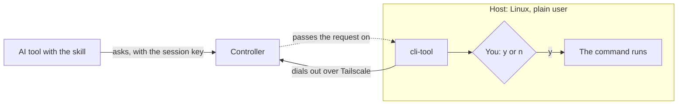

# Gangway

Temporary remote access for AI, with just-in-time approval of commands.

An AI tool such as Claude Code asks to run a command on a remote machine. A person at that machine sees the exact command and presses `y` or `n`. Nothing runs without a yes.

It exists because SSH gives an AI a full shell with no say over the commands.

<!-- demo recording goes here -->

## What it looks like

On the remote machine, the host, you start a session and paste one line to the AI:

```
$ gangway
Joining Tailscale ...
Connected. The session is live.
Paste this line to the AI:

/gangway https://controller.example gw_4f9c…

Each request is shown here. Press y to run it, n to refuse. Ctrl+C ends the session.
The session lasts 30 minutes. Then you are asked whether to extend it.
The session is logged at /tmp/gangway-2780822553/session.txt
```

From then on, each command the AI wants is shown to you first:

```
AI asks to run:
  > grep ERROR app.log | tail -n 20
Run it? y/n y
  | 14:02:11 ERROR disk full
  | 14:02:15 ERROR disk full
```

The AI gets the same output. On `n` it gets "refused", and nothing runs.

## How it works



Three parts:

- **The cli-tool** runs on the host. It shows each request, asks you, and runs what you approve. One file, no install.
- **The controller** is what the AI calls. It passes each request to the host and the answer back.
- **The skill** teaches the AI how to ask.

## What keeps it safe

- **The gate is on the host, never in the AI.** The thing being checked is not the checker. A controller that is taken over can only ask.
- **Every command is shown, and needs a `y`.** You approve the exact line that runs.
- **The prompt shows what runs.** A request with a control character or an invisible character is refused before it reaches you.
- **The host is never open to the internet.** It dials out to the controller over Tailscale, which is built into the program: no root, nothing to install.
- **The session key works for the first AI only.** A copy of the key is of no use to a second caller.
- **Access ends by itself.** A session lasts 30 minutes. Only the person at the terminal can extend it, and no answer means no.
- **An admin can cap it.** Root sets the longest a session may last, in `/etc/gangway/settings`. Nothing below root can raise it.
- **Every session is logged on the host.** Each request, your answer and the output go to a text file that only you can read. No log, no session.
- **Plain user only.** The cli-tool refuses to run as root.

## Quick start

You need a Tailscale network, a machine for the controller, and Go to build the two programs.

1. Build: `./build.sh` puts `gangway` and `gangway-controller` into `build/`. Each is one file that can be copied to another Linux machine as it is.
2. In the Tailscale admin page, make two auth keys. The one for the controller: reusable and not ephemeral. The one for the hosts: reusable and ephemeral, with a tag that your Tailscale rules let reach the controller and nothing else.
3. On the controller machine, once: `gangway-controller login`, and paste the controller's key. Then start it: `gangway-controller`. Add `-public-address https://…` when the AI reaches it at another address than the one it listens on.
4. On a host, once: `gangway login`, and paste the hosts' key. Then start a session: `gangway`. For another length than 30 minutes: `gangway --length 45m`.
5. Paste the line it prints to an AI that has the skill in `skill/gangway/`. In Claude Code, copy that folder to `~/.claude/skills/`.

The controller and each host join your Tailscale network from inside the program. A Tailscale that is already on the machine is left alone.

To cap how long a session on a host may last, extensions included: as root, write `SESSION_MAX = 2h` into `/etc/gangway/settings`. Root must own the folder and the file, and nobody else may be able to write them. With no such file there is no cap.

The log of a session is a text file in a new folder under the temp folder. The terminal shows its path when the session starts and when it ends. The cli-tool does not delete it, but the system empties the temp folder, on many hosts at every start.

Until pairing is built, any device that your Tailscale rules let reach the controller can start a session of its own. The rules are the guard.

## Status

It works end to end, and it has run on a real Tailscale network, with the controller on a server on the internet.

It is early. It is made for one user, and hosts are Linux only. Not built yet: the dashboard, the login, pairing a host to a user, and "always allow" rules.

## Known limits

- **Chat windows on the web probably cannot use it as it is.** The AI must be able to send a POST request with the key in a header. A tool with a shell can, such as Claude Code. A chat on the web usually can only read a web address.

## More

- [`DEVELOPMENT.md`](DEVELOPMENT.md): how to build it, try it on one machine, and run the tests
- [`blueprint.md`](blueprint.md): the design
- License: [MIT](LICENSE)
