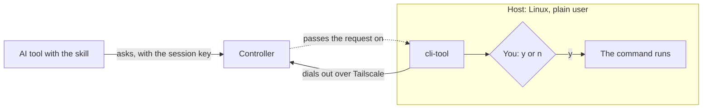

# Gangway


Temporary remote access for AI, with just-in-time approval of commands.

An AI tool such as Claude Code asks to run a command on a remote machine. A person at that machine sees the exact command and presses `y` or `n`. Nothing runs without a yes.

It exists because SSH gives an AI a full shell with no say over the commands.

To run the tests yourself, or to work on the code, see [DEVELOPMENT.md](DEVELOPMENT.md).

<!-- demo recording goes here -->

## What it looks like

On the remote machine, the host, you start a session and paste one line to the AI:

```
$ gangway
   ____
  / ___| __ _ _ __   __ ___      ____ _ _   _
 | |  _ / _` | '_ \ / _` \ \ /\ / / _` | | | |
 | |_| | (_| | | | | (_| |\ V  V / (_| | |_| |
  \____|\__,_|_| |_|\__, | \_/\_/ \__,_|\__, |
                    |___/               |___/

  Joining Tailscale ...

  host      build-box
  session   30 min, then you are asked to extend
  network   connected over Tailscale
  log       /tmp/gangway-220257878/session.txt

  Paste this line to the AI:

/gangway https://controller.example gw_4f9c…
```

From then on, each command the AI wants is shown to you first:

```
  ── request 1 ──────────────────────────  29 min left

  > grep ERROR app.log | tail -n 20

  run it?   y yes   n no 
```

Press `y`, and it runs:

```
  ── request 1 ── running ───────────────  Ctrl+C stops it

  │ 14:02:11 ERROR disk full
  │ 14:02:15 ERROR disk full

  ✓ ended, exit 0, 2 lines sent to the AI
```

The AI gets the same output. On `n` it gets "refused", and nothing runs.

## How it works



Three parts:

- **The cli-tool** runs on the host. It shows each request, asks you, and runs what you approve. One file, no install.
- **The controller** is what the AI calls. It passes each request to the host and the answer back.
- **The skill** teaches the AI how to ask.

## Try it on one machine

Both programs run on the same machine and talk over localhost. Nothing leaves the machine. You need no Tailscale and no auth keys.

**1. Install both programs**

```
curl --proto '=https' --tlsv1.2 -fsSL https://raw.githubusercontent.com/kdop/gangway/main/install.sh | sh -s -- all
```

**2. Start the controller**

In terminal 1:

```
gangway-controller -local
```

**3. Start a session**

In terminal 2:

```
gangway --local
```

It prints a line such as `/gangway http://127.0.0.1:8642 gw_4f9c…`.

**4. Send a command**

Paste the line to an AI that has the skill in `skill/gangway/`. Or send a command by hand, from a third terminal.

Set the address and the key from the printed line:

```
GW=http://127.0.0.1:8642
KEY=gw_4f9c…
```

Say hello, once. The answer holds a `caller_token`:

```
curl -sS -X POST "$GW/v1/hello" -H "Authorization: Bearer $KEY"
CALLER=gwc_81b2…
```

Ask for a command:

```
curl -sS -X POST "$GW/v1/requests" \
  -H "Authorization: Bearer $KEY" -H "Gangway-Caller: $CALLER" \
  -H "Content-Type: application/json" \
  -d '{"kind":"command","command":"uname -a"}'
```

The prompt shows in terminal 2. Press `y`, and the `curl` gets the output.

The whole API, for use by hand, is in [`docs/api.md`](docs/api.md).

## Install with Tailscale

The host is never open to the internet. Each program carries Tailscale inside it and joins your Tailscale network by itself, with no Tailscale install and no root. The host dials out to the controller by its Tailscale name, and the AI calls the controller's API.

**1. Make two auth keys**

In the Tailscale admin page, make two auth keys. The one for the controller: reusable and not ephemeral. The one for the hosts: reusable and ephemeral, with a tag that your Tailscale rules let reach the controller and nothing else.

**2. Set up the controller**

On the controller machine, install it:

```
curl --proto '=https' --tlsv1.2 -fsSL https://raw.githubusercontent.com/kdop/gangway/main/install.sh | sh -s -- controller
```

Store the controller's key, once. Then start it:

```
gangway-controller login
gangway-controller
```

Add `-public-address https://…` when the AI reaches it at another address than the one it listens on.

**3. Set up each host**

On the host, install the cli-tool:

```
curl --proto '=https' --tlsv1.2 -fsSL https://raw.githubusercontent.com/kdop/gangway/main/install.sh | sh
```

Store the hosts' key, once. Then start a session:

```
gangway login
gangway
```

For another length than 30 minutes: `gangway --length 45m`.

**4. Paste the line to the AI**

Paste the line it prints to an AI that has the skill in `skill/gangway/`. In Claude Code, copy that folder to `~/.claude/skills/`.

A Tailscale that is already on the machine is left alone.

To cap how long a session on a host may last, extensions included: as root, write `SESSION_MAX = 2h` into `/etc/gangway/settings`. Root must own the folder and the file, and nobody else may be able to write them. With no such file there is no cap.

The log of a session is a text file in a new folder under the temp folder. The terminal shows its path when the session starts and when it ends. The cli-tool does not delete it, but the system empties the temp folder, on many hosts at every start.

Until pairing is built, any device that your Tailscale rules let reach the controller can start a session of its own. The rules are the guard.

## More on installing

### System requirements

Both programs run on **Linux**, on x86_64 or aarch64. You need no root.

### Read the script first, or install a set version

> You can skip this if the latest release is all you want.

To read the script before it runs:

```
curl --proto '=https' --tlsv1.2 -fsSL -o install.sh https://raw.githubusercontent.com/kdop/gangway/main/install.sh
less install.sh
sh install.sh
```

To install a set version, of the cli-tool or of the controller:

```
sh install.sh v0.1.0
sh install.sh controller v0.1.0
```

Each program is one file in `~/.local/bin`, checked against the checksums of its release. The script changes nothing else.

### Build from the source

With Go:

```
./build.sh
```

This puts `gangway` and `gangway-controller` into `build/`. Each is one file that can be copied to another Linux machine as it is.

> The checksum shows the download is whole. It is not a signature: whoever can change a release can change both. The build from the source needs no trust in a release.

### Add to your PATH

If your shell does not find `gangway`, add `~/.local/bin` to your `PATH`:

```
export PATH="$HOME/.local/bin:$PATH"
```

### Update

Run the install command again. It replaces the program.

### Uninstall

The cli-tool, with its stored key and settings:

```
rm ~/.local/bin/gangway
rm -r ~/.config/gangway
```

The controller, with its stored key and its Tailscale identity:

```
rm ~/.local/bin/gangway-controller
rm -r ~/.config/gangway-controller ~/.local/state/gangway-controller
```

## Known limits

- **Chat windows on the web probably cannot use it as it is.** The AI must be able to send a POST request with the key in a header. A tool with a shell can, such as Claude Code. A chat on the web usually can only read a web address.

## No guarantees

This software is provided "as is", with absolutely no guarantees of any kind. It runs commands on your machines. You use it at your own risk. The [license](LICENSE) has the full text.

## License

[MIT](LICENSE)
