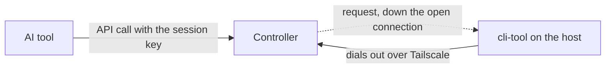

# Gangway blueprint

Gangway: remote access for AI, with just-in-time approval of commands.

High level only. Steps and checks are in `plan.md`. Reasons for each decision are in `CLAUDE.md`.

## The problem

Remote machines often have no AI on them. To debug one today, the AI tells the user what to type, and the user copies and pastes both ways. The AI should read files and run commands on the host itself.

SSH would do that, but SSH hands over a shell. The user has no say over what runs in it. That is too much to give an AI.

## What Gangway does

The AI asks. A person at the host says yes or no. Only then does the command run.

- Default is no. Nothing runs without a yes.
- Nothing is hidden. The cli-tool's terminal shows everything the AI does on the host: each request, the answer given, the output as it is sent back, and how the command ended. This holds also for requests that need no prompt, such as a read inside a granted folder or a command under an allow rule.
- Access is short. A session ends on Ctrl+C or when its time is up.
- Hosts are Linux only for now.

## Parts

| Part | Runs on | Job |
|---|---|---|
| **cli-tool** | The host | Starts a session, shows each request, asks for approval, runs what is approved, sends back the result |
| **controller** | A machine on the Tailscale network | A web app: a REST API and a dashboard. Passes requests from the AI to the cli-tool and results back. Runs nothing itself |
| **skill** | The AI tool | Teaches the AI how to call the controller with the session key |

## How they talk

An arrow points from the side that dials to the side that listens. The dotted arrow is not a new connection: the request travels down the one the cli-tool opened.

- The cli-tool dials out to the controller over Tailscale. The host listens on nothing.
- Tailscale is built into the cli-tool. The host needs no Tailscale install and no root.
- The AI calls the controller's API. The AI machine must reach the address the controller listens on: the same machine by default, or Tailscale or a public address when set so.
- The controller can answer on a public address, so a cloud AI, a browser or a phone can reach it. The hosts still reach it over Tailscale only.

## Pairing a host

Pairing ties a host to a user. It is done once per host, at `login`. Without it the controller does not know whose host is calling, and refuses the connection.

1. The user runs `login` on the host and pastes the Tailscale auth key. The cli-tool joins the network and reaches the controller.
2. The cli-tool asks the controller for a pairing code and shows it: short, used once, dead after a few minutes.
3. The user signs in to the dashboard and types the code.
4. The cli-tool shows the account that claimed the host and asks `y`/`n`. Whoever types the code first would otherwise get the host.
5. On `y`, the controller gives the cli-tool a host token. On `n`, or with no answer before the code dies, the code is dead and the host stays unpaired.

After pairing:

- The host token is kept on the host like the auth key: its own file, readable by its owner only, never given to the AI.
- At every start the cli-tool shows the token to the controller. The controller then knows the user, and the session belongs to that user.
- The controller keeps only a hash of the token, with the host and the user.
- The user can remove a host in the dashboard. Its token is dead from then on, a live session of that host ends at once, and the host must be paired again.
- No password is typed on the host, at any point.

## The session

A session is one stretch of access to one host. It starts when the user starts the cli-tool on that host, and it ends on Ctrl+C or when its time is up. While it lives, the AI that holds its key can ask for commands and files on that host. Before it starts and after it ends, nothing can be asked.

One session has one host, one session key and one open connection to the controller.

A quiet session is not ended for being quiet. It lives until its time is up, whether the AI asks for much or for nothing.

1. The user starts the cli-tool on the host. It joins the Tailscale network by itself and connects to the controller. It shows the controller the host token it got at pairing, so the controller knows which user this host belongs to.
2. The cli-tool makes a session key: a long random secret that works for this session only. It then prints one line of text with the skill's name, the controller's address and that key. The exact form is in `ux.md`. That line is all the AI needs to send requests to this host.
3. The user pastes the line to the AI. The skill knows what to do with it. Nothing is pasted to the controller: the cli-tool has already sent it the key over their connection.
4. The AI asks to run a command or read a file. The controller passes the request to the cli-tool.
5. The cli-tool shows the request in its terminal. The user presses `y` (yes) or `n` (no).
6. On yes, the cli-tool runs it as the plain user and sends back the result. On no, the AI is told it was refused.
7. The session ends on Ctrl+C, or when its time is up and the user does not extend it. The key is dead after that, and the host drops off the Tailscale network.

Every session is new. A session that has ended is never resumed, and nothing of it is kept on disk. A lost connection is a different matter: the cli-tool, still running, connects again by itself within a short time and the session carries on.

## The controller

- A web app with two faces: a REST API for the AI, and a dashboard for the user.
- The dashboard shows the live sessions and the log of requests and answers, and has a button to end a session.
- The dashboard does not approve commands in the first version. Approval stays on the host.
- Where it listens is a setting, not a design matter. By default it answers on localhost only. It can be set to answer on Tailscale or on a public address.
- It has a login. The dashboard asks for the login. The API asks for the session key. See "Login and users".
- Until the login is built, it must not be set to answer on a public address.
- Built in Go, as one program. Pages are made on the server with Go's own templates, plus htmx for live updates. No Vue or React, and no build step, until the dashboard grows enough to need them.

## Joining Tailscale

- The cli-tool is written in Go and uses `tsnet`, Tailscale's library that puts Tailscale inside a Go program. It needs no root and no system service.
- It joins with a Tailscale auth key, not a browser login. The key is made in the Tailscale admin page.
- The user runs `login` once after install and pastes the key. After that, starting a session asks for nothing. The key lasts 90 days at most, then `login` is run again.
- The key is kept in a file in the home folder that only its owner can read. The exact place follows the usual practice for such files and is picked when it is built.
- The cli-tool never gives that file to the AI. The ban is fixed in the code, not a setting. Limit: this is sure for file reads. An approved command could still print the file, so the user must refuse such a command.
- The key is ephemeral: Tailscale removes the host from the network after it goes offline.
- Each start joins as a new device, kept in memory only. The key must be the reusable kind.
- The controller joins the same way, from inside the program, with its own key and its own `login`. Its device is kept, so its name stays. The hosts dial that name, `gangway-controller`.
- A host or a controller machine that already has Tailscale installed keeps it. The device inside the program is a second, separate one.
- Each program can be started in a one-machine mode with no Tailscale, on localhost only.
- The key carries a tag. The Tailscale rules let that tag reach the controller and nothing else.
- Later: the controller makes a fresh one-off auth key per session through the Tailscale API.

Sources: https://tailscale.com/kb/1244/tsnet, https://pkg.go.dev/tailscale.com/tsnet, https://tailscale.com/kb/1085/auth-keys

## The gate

- The gate lives in the cli-tool, on the host. The host is what gets hurt, so the host has the last word.
- Reading a file is a request like any other. It passes the gate too.
- An approved command runs through a shell, so pipes and redirection work. One line can then hold several commands, and one `y` covers the whole line. The prompt shows the whole line.
- A key does not count for a short time after a prompt is shown. A new prompt can replace an old one just as the user presses `y`, and the key would then approve a request the user did not read.
- A request that holds a control character is refused before any prompt. Only line breaks and tabs are let through. Such characters could move the cursor and paint over the real command, so the user would approve something other than what they read.
- For the same reason, the output shown on the terminal is cleaned of control characters. The AI still gets the output unchanged.
- Every line of output is shown with a mark in front. A command cannot print something that passes for a prompt of the cli-tool.
- A request that holds an invisible character, or one that changes the reading order of the text, is refused the same way. The prompt would show a line that differs from the line that runs.
- In the first version every request is asked, each time. "Always allow" comes in the second stage.
- The gate is never in the AI, and in the first version never in the controller. If the yes came from the controller, the cli-tool could not tell a real yes from a fake one.
- Later, as a choice switched on per session: approve from the dashboard. Good for many hosts or a phone. It means trusting the controller. The cli-tool keeps its hard limits either way.

## Limits on a command

For safety, so nothing hangs forever. Not meant to be strict.

Gangway is for an AI to look into a small problem on a host. It is not for moving data. The size limit follows from that.

- **Time.** When a command passes the time limit, the AI is told it is still running and is asked: wait more, or stop?
- **Size.** When the output passes the size limit, the cli-tool stops sending. Nobody is asked. The command is not killed and runs to its end. The AI gets the first part, the exit code, and a note at the end that the output was cut. A small limit is good: it pushes the AI to ask for less, with `head`, `tail` or a sharper command.
- The time question goes to the AI through the controller. The AI knows why it ran the command, and its call must get "still running" in any case, because AI tools cut off a call that takes too long. The cli-tool does the stopping, since it holds the running command.
- If the AI hangs up while a command runs, the cli-tool kills the command. Nobody is left to receive the result.
- The user keeps the last word. One Ctrl+C in the cli-tool's terminal cancels what is in front: it kills the running command, or refuses the request at a waiting prompt. The session lives on. A Ctrl+C with nothing in front ends the session.
- Two Ctrl+C close together always end the cli-tool, whatever state it is in. An AI that sends request after request cannot keep the user from getting out.
- The question "wait more, or stop?" has a time limit of its own. If no answer comes in that time and the command is still running, the cli-tool kills the command. If the command ends by itself in that time, its result is sent as usual.
- All three limits are settings. Starting values: 60 seconds for a command, 100 KB of output, 60 seconds for the question, which leaves an AI time to answer.
- Ending the session stops any running command.
- A command gets no keyboard. A read from its input finds the end at once, so a command that asks a question does not hang. It runs with `PAGER=cat` and `TERM=dumb`, so tools print plain text and do not open a pager.
- Killing a command kills every program it started. The command is first asked to stop, so it can clean up, and is killed by force after a short time if it still runs.
- A command is over when its shell ends. A program it left in the background runs on and is not killed: starting a service again is a normal thing to do while debugging. Such a program must send its output to a file.

## Folder grants (later stage)

Not in the first version. Until then every file read is asked like a command.

- On start, the user names the folders the AI may read, for example `--allow /var/log --allow ~/app`.
- A file inside a granted folder is read without a prompt. Naming the folder was the yes.
- A file outside every granted folder is refused, with no prompt.
- The cli-tool checks the real path, so a link that points outside a granted folder is refused.
- Limit: this holds for file reads only. A command can touch any path the plain user can. Commands are still approved one by one, and they start in a granted folder. Locking a command inside a folder needs a sandbox, which comes later still.

## Always allow (second stage)

Not in the first version. Ideas so far, nothing fixed:

- The prompt gets more answers: yes, no, always allow.
- Always allow for the exact command is weak: the AI may never ask the same command again.
- So also: always allow the program, for example "always allow `ls`".
- And: a list of safe, read-only commands that can be allowed as a group.
- The choice can hold for one session, or be saved for later sessions.
- An allow rule is a shortcut, not the gate. It holds what the user already said yes to.

Traps to handle when this is built:

- A command allowed by its program name must run with no shell. Otherwise `ls; rm -rf x` passes as `ls`.
- Programs that can run other programs or write files stay off any safe list, for example `find` (it has `-exec`).
- Read-only is not the same as harmless. `cat` on a key file leaks the key.

## Settings

Settings on the host come in three layers. Each layer can only narrow the one above it, never widen it.

| Layer | Where | Who can change it | Holds |
|---|---|---|---|
| Admin | `/etc/gangway/` | Root only, with sudo | The outer bounds: the folders that may ever be granted, and the maximum session length |
| User | `~/.config/gangway/` | The user | The user's own defaults: the controller's Tailscale name, session length, time and size limits |
| Session | Start options | The user, at each start | The choices for this one session, such as the granted folders and the length |

- The admin layer exists because an approved command runs as the plain user, and the plain user can rewrite `~/.config/gangway/`. A bound kept only there could be changed by one careless `y`. A file owned by root cannot.
- The cli-tool only reads `/etc/gangway/`. It never runs as root.
- With no admin file, there are no admin bounds, and the user layer is the top.
- When the user asks for more than an admin bound allows, the cli-tool starts with the bound and says so. It does not refuse to start.

## What is stored

No database in the first version. Plain files only.

On the host:

| What | Where |
|---|---|
| Admin bounds: grantable folders, maximum session length | `/etc/gangway/`, owned by root |
| Settings: the controller's Tailscale name, session length, time and size limits | `~/.config/gangway/` |
| Tailscale auth key from `login` | Same folder, own file, readable by its owner only |
| Host token from pairing | Same folder, own file, readable by its owner only |
| Log of requests, answers and output. A new file is started at a set size, and only the last few are kept | `~/.local/state/gangway/` |
| Saved allow rules (second stage) | `~/.config/gangway/` |

On the controller:

- Paired hosts are kept in a small file: the host, the user, and a hash of the host token. They must outlive a restart, or every host would need pairing again.
- Live sessions are kept in memory only. If the controller restarts, every session ends and new ones must be started.
- Its settings, such as where it listens, are a small file or start options.
- The dashboard shows what happened since the controller started. The full record is the log on each host. History that survives a restart comes later, in one SQLite file.

Sessions are never stored. Nothing is left on disk that could be picked up and used again.

## The session key

- Made by the cli-tool, long and random, easy to copy.
- Lives as long as the session: 30 minutes by default. See "Session length".
- Belongs to the first AI that uses it. A second user of the same key is refused. On the first call the controller hands that AI a token of its own, and every later call must carry it. That is how the controller tells the first AI from anyone else. Sharing one session between several AIs may come later.
- It gives the right to ask, not the right to run. A stolen key gets a stranger a prompt that the user refuses.
- The API has no login. Whoever holds the key can ask, and nothing else is checked. For that to be safe on a public address:
  - The key has enough random bits that guessing is hopeless.
  - The API answers over HTTPS only, so the key is never seen on the way.
  - Many wrong keys from one address get that address blocked for a while.

## Login and users

- The login is a social login: the user signs in with an account they already have. The controller stores no password. Google is the first provider.
- Only accounts on a list in the controller's settings may sign in. Today the list holds one account. Anyone else is refused, even with a valid account at the provider.
- Built for more users later: every host and every session belongs to a user.
- A host is tied to a user by pairing. See "Pairing a host".
- A user sees and ends only their own sessions.

## Session length

- The default is 30 minutes. It is a setting on the host.
- The user can pick another length when starting a session.
- When the time is up, the cli-tool asks in its terminal whether to extend. On `y` the session gets another stretch of the same length it started with. No answer within a short time means no, and the session ends.
- There is a maximum, set in the admin layer, `/etc/gangway/`. See "Settings". It caps the whole session, extensions included. At the maximum the session ends with no question.
- When the time is up, or the maximum is reached, in the middle of something:
  - New requests are refused from that moment.
  - A waiting prompt is refused. Nothing has run.
  - A running command is not killed. It may finish, but it gets no more "wait more": at its next time limit it is killed. A command cut halfway could leave the host in a broken state.
  - The question to extend comes after that.
- Known weakness, accepted for now: a command can outlive the session's time by up to one command time limit.
- Only the person at the host terminal can change the length. The AI and the controller can never make a session longer.

## Security

This is remote command running by design. The aim is a door that is narrow, in plain sight and short-lived.

| Risk | Answer |
|---|---|
| Stolen session key | It only lets someone ask. It dies with the session. It is tied to the first AI |
| Controller taken over | It can only ask. The gate on the host still decides |
| AI asks for something harmful | The user sees the exact command before it runs and says no |
| The user approves without reading | Not solved by code. Short sessions and a log limit the harm |
| Tool runs with too much power | Runs as a plain user. Refuses to start as root |
| Host stays on the network | It joins as an ephemeral, tagged machine. It can reach only the controller and is removed after it goes offline |
| Controller on a public address | The dashboard needs a social login, and only listed accounts get in. The API needs a session key |
| Someone else learns the pairing code | It works once and dies in minutes. The host shows who claimed it and asks `y`/`n` |
| Left running by mistake | Runs only in an open terminal, never in the background. Ends when its time is up unless the user extends it at the terminal, and never runs past the maximum |

Every request and its answer is written to a log on the host, with the output that was sent to the AI. Only the user can read the log.

## Not in the first version

- Resuming a session
- sudo
- A second user. The design is ready for one; the first version has one account on the list
- Approving from the dashboard or another device
- Dashboard history that survives a restart
- Always allow, and lists of safe commands
- A fresh Tailscale auth key per session, made by the controller
- Folder grants, and a sandbox that locks commands inside the granted folders

## Open questions

None right now.
