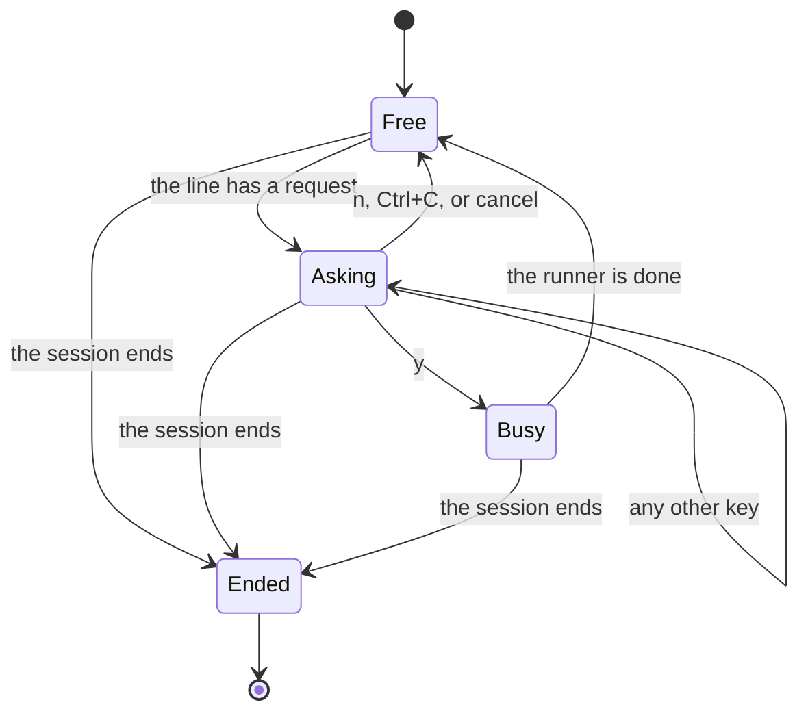
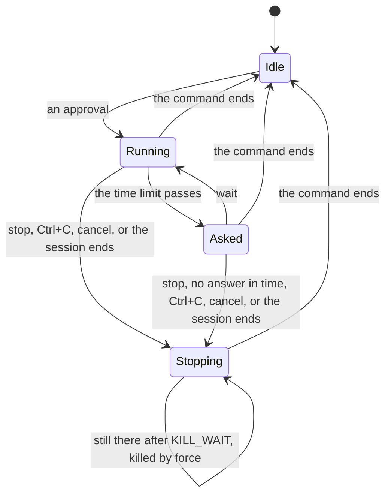
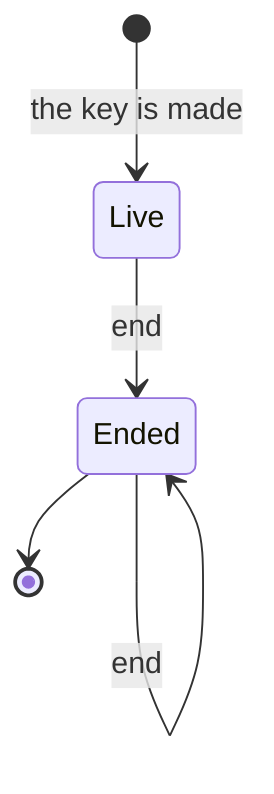
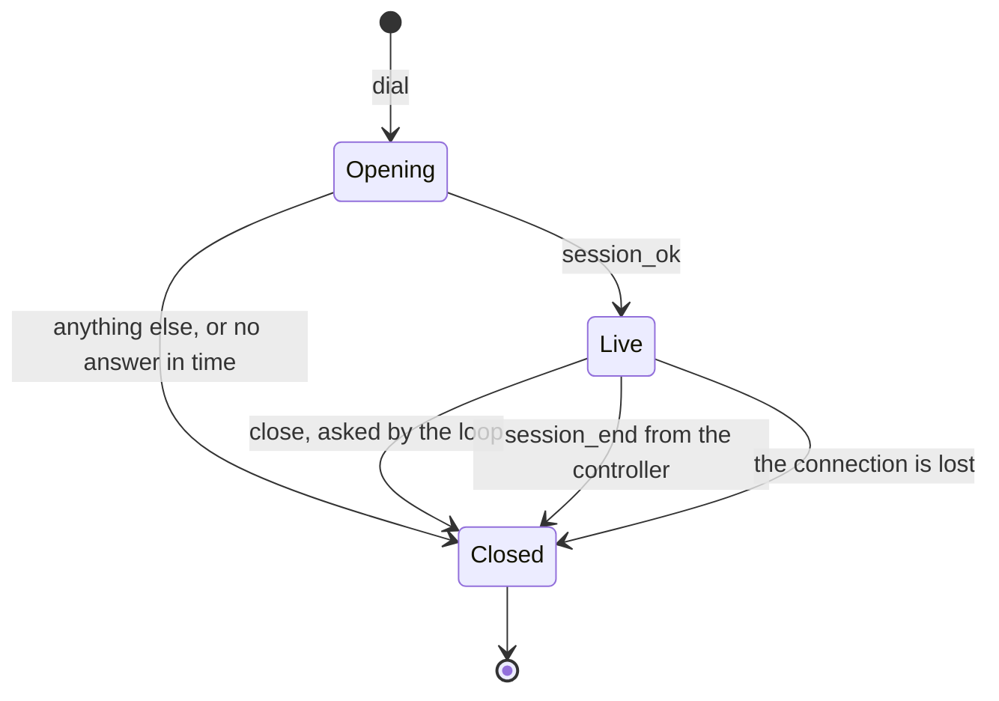
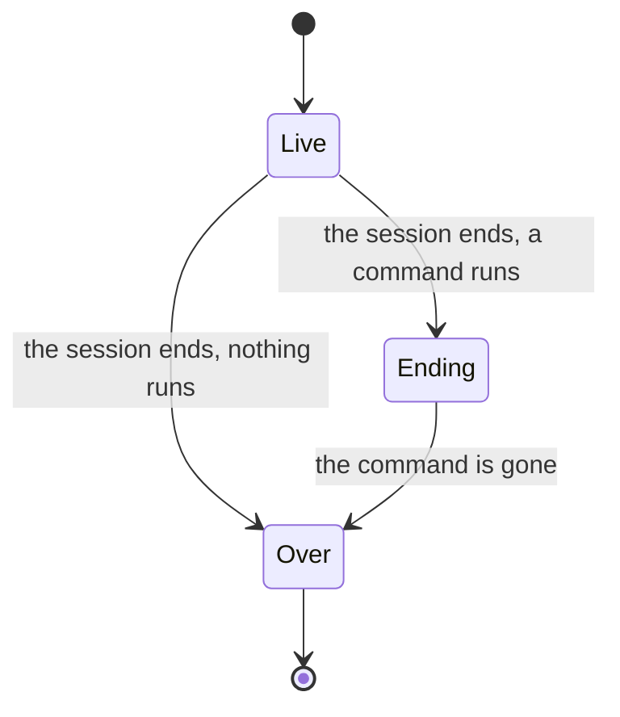
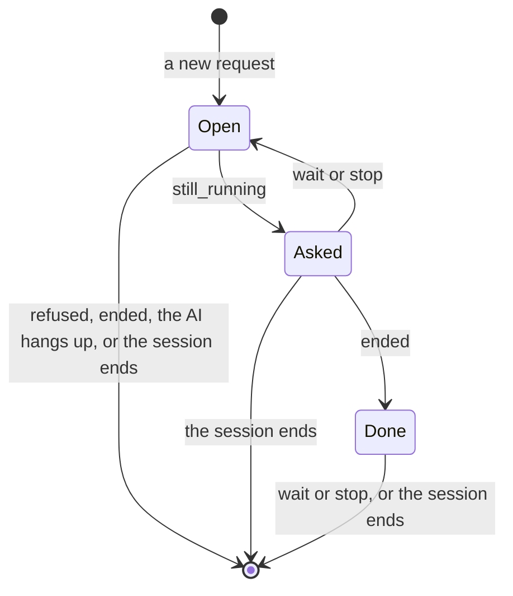

# Gangway detailed design and unit tests

The inside of each piece, with the unit tests that check it. A piece is added here just before it is built. The pieces and how they fit are in `architecture.md`.

A unit test runs one piece alone. The pieces around it are fakes that record what they were asked.

Each unit test names the requirements it helps to prove. The Go test carries the same line in a comment, and a Go test fails when the two differ or when an ID is not in `requirements.md`.

## `gate`

The `gate` shows one request and takes the `y` or `n`. It is the only way to the `runner`.

### What it holds

- Its state.
- The request in front, if there is one.
- The time the prompt in front was shown.

### What it talks to

| Piece | The `gate` asks it to |
|---|---|
| `line` | Give the oldest waiting request |
| `terminal` | Show the prompt, and show the answer |
| `connection` | Send `started` or `refused` |
| `runner` | Run an approved request |
| The clock | Tell the time |

### States

| State | Meaning |
|---|---|
| `Free` | Nothing is in front |
| `Asking` | A prompt is on the screen and waits for a key |
| `Busy` | An approved request is with the `runner` |
| `Ended` | The session is over. Final |



### Events

| Event | Comes from |
|---|---|
| `ready` | `line`: a request waits. Sent when a request arrives, and asked for again each time the `gate` becomes `Free` |
| `key` | `terminal`: one key press |
| `ctrl_c` | `terminal`: one Ctrl+C |
| `cancel` | `connection`: the AI hung up on the request with this `id` |
| `done` | `runner`: the request it was given is over |
| `end` | `session`: the session ends, for any reason |

### The table

Every state meets every event. An empty "Does" means the event is dropped.

| State | Event | Does | Next |
|---|---|---|---|
| `Free` | `ready` | Takes the oldest request from `line`. Shows the prompt. Notes the time | `Asking` |
| `Free` | `key` | | `Free` |
| `Free` | `ctrl_c` | Not the gate's. `session` ends the session | `Free` |
| `Free` | `cancel` | Not the gate's. `line` removes the request if it waits | `Free` |
| `Free` | `done` | | `Free` |
| `Free` | `end` | | `Ended` |
| `Asking` | `ready` | | `Asking` |
| `Asking` | any `key`, less than `PROMPT_MIN_SHOW` after the prompt was shown | | `Asking` |
| `Asking` | `key` `y` | Shows the answer. Sends `started`. Hands the request to `runner` | `Busy` |
| `Asking` | `key` `n` | Shows the answer. Sends `refused` with `user` | `Free` |
| `Asking` | any other `key` | | `Asking` |
| `Asking` | `ctrl_c` | Shows the answer. Sends `refused` with `user` | `Free` |
| `Asking` | `cancel`, the `id` in front | Shows that the AI left. Sends `refused` with `ai_gone` | `Free` |
| `Asking` | `cancel`, another `id` | Not the gate's | `Asking` |
| `Asking` | `done` | | `Asking` |
| `Asking` | `end` | Sends `refused` with `session_ended` | `Ended` |
| `Busy` | `ready` | | `Busy` |
| `Busy` | `key` | | `Busy` |
| `Busy` | `ctrl_c` | Not the gate's. `runner` kills the command | `Busy` |
| `Busy` | `cancel` | Not the gate's. `runner` kills the command if the `id` is its own | `Busy` |
| `Busy` | `done` | | `Free` |
| `Busy` | `end` | Not the gate's. `runner` stops the command | `Ended` |
| `Ended` | any | | `Ended` |

Each time the `gate` becomes `Free`, it asks `line` whether a request waits. If one does, that is a `ready`.

### Rules the code must keep

- **One way to the runner.** The `runner` starts a request only when it is handed an approval. Only the `gate` can make an approval, and it makes one in a single place: `Asking` with `key` `y`. No other code can build one. (`GATE-01`, `GATE-07`)
- **What was shown is what runs.** The approval carries the request itself, the same value the prompt was drawn from. The `runner` runs what is in the approval and takes the request from nowhere else. (`GATE-05`)
- **An approval works once.** It names one request, and the `runner` refuses it a second time. (`GATE-15`)
- **A key is never kept.** A `key` that does not answer a prompt is dropped at once. Nothing stores it for a later prompt. (`GATE-04`)
- **Exactly two keys answer.** The key must be the single byte `y` or the single byte `n`. Capitals, Enter, and every key that sends more than one byte are other keys. (`GATE-03`)
- **A fresh prompt takes no key.** A `key` that comes less than `PROMPT_MIN_SHOW` after the prompt was shown is dropped, `y` and `n` too. `ctrl_c` is not held back: it can only refuse. (`GATE-14`)
- **One answer for each request.** Every request the `gate` takes ends with one `started` or one `refused` from it, never both and never none.

The session's clock is not in the MVP. When it is built, it adds one event, "the time is up", to this table.

### Unit tests

Start: a `gate` with a fake `line`, `terminal`, `connection` and `runner`, and a clock the test moves. In a test that starts in `Asking`, `PROMPT_MIN_SHOW` has passed unless the test says otherwise.

| Test | Requirement | Start | Action | Expect |
|---|---|---|---|---|
| UNIT-GATE-01 | `GATE-01`, `GATE-05` | `Free`, one request in the line | `ready` | `Asking`. The prompt holds the request's exact text. The runner was not called |
| UNIT-GATE-02 | `GATE-01`, `GATE-05` | `Asking` | `key` `y` | `Busy`. `started` was sent. The runner got an approval that holds the same request as the prompt |
| UNIT-GATE-03 | `GATE-02` | `Asking` | `key` `n` | `Free`. `refused` with `user`. The runner was not called |
| UNIT-GATE-04 | `GATE-03` | `Asking` | In turn: `Y`, `N`, Enter, space, Escape, an arrow key, `x` | Still `Asking` after each one. Nothing was shown, sent or run |
| UNIT-GATE-05 | `LIM-09` | `Asking` | `ctrl_c` | `Free`. `refused` with `user`. The runner was not called |
| UNIT-GATE-06 | `GATE-12` | `Asking`, request A in front | `cancel` for A | `Free`. `refused` with `ai_gone`. The runner was not called |
| UNIT-GATE-07 | `GATE-12` | `Asking`, request A in front | `cancel` for B | Still `Asking`, with A in front. Nothing was sent |
| UNIT-GATE-08 | `GATE-01` | `Asking` | `end` | `Ended`. `refused` with `session_ended`. The runner was not called |
| UNIT-GATE-09 | `GATE-04` | `Free`, the line is empty | `key` `y`, then a request arrives and `ready` | `Asking`. The early `y` did not answer it |
| UNIT-GATE-10 | `GATE-04` | `Busy` | `key` `y`, then `done`, with a second request in the line | `Asking` for the second request. The `y` did not answer it |
| UNIT-GATE-11 | `GATE-06` | `Busy`, a second request in the line | `ready` | Still `Busy`. No second prompt. The line still holds the request |
| UNIT-GATE-12 | `GATE-02`, `GATE-06`, `GATE-14` | `Asking`, a second request in the line | `key` `n`, twice with no time between | `refused` for the first, then `Asking` for the second. The second `n` did not answer it |
| UNIT-GATE-13 | `GATE-06` | `Busy`, the line is empty | `done` | `Free`. No prompt |
| UNIT-GATE-14 | `SES-03` | `Ended` | Each event in turn | Still `Ended`. Nothing was shown, sent or run |
| UNIT-GATE-15 | `GATE-01`, `GATE-07` | Each state in turn | Each event in turn, except `key` `y` in `Asking` | The runner was never called |
| UNIT-GATE-16 | `GATE-01`, `GATE-05`, `GATE-07` | `Free` | A long run of events picked at random | The runner was called exactly as many times as `key` `y` came in `Asking`, each time with the request that was in front. Every request taken got one `started` or one `refused` |
| UNIT-GATE-17 | `GATE-15` | An approval that the runner has used | The same approval is handed to the runner again | The runner refuses it. Nothing runs |
| UNIT-GATE-18 | `GATE-14` | `Asking`, the prompt just shown | `key` `y`, then `key` `n`, with no time passed | Still `Asking`. Nothing was sent or run |
| UNIT-GATE-19 | `GATE-14` | State after UNIT-GATE-18 | The clock moves by `PROMPT_MIN_SHOW`. `key` `y` | `Busy`. The runner got the approval |
| UNIT-GATE-20 | `GATE-14`, `LIM-09` | `Asking`, the prompt just shown | `ctrl_c`, with no time passed | `Free`. `refused` with `user` |
| UNIT-GATE-21 | `GATE-12`, `GATE-14` | `Asking` for A, B in the line | `cancel` for A, then `key` `y` with no time passed | `Asking` for B. The runner was not called |

## `checks`

`checks` looks at a request before anything else does, and refuses it or lets it pass. It holds nothing and has no states: the same request always gets the same answer.

### What it refuses

A request is refused with the reason `control_character` when its text holds any of these:

| What | Which characters |
|---|---|
| A control character of the first set | Codes 0 to 31, except the line break (10) and the tab (9) |
| Delete | Code 127 |
| A control character of the second set | Codes 128 to 159 |
| Bytes that are not text | Anything that is not valid UTF-8 |
| A character that changes the reading order | The marks that turn text right to left or back, such as codes 8234 to 8238 and 8294 to 8297 |
| An invisible character | The zero-width space and joiners, the soft hyphen, the byte order mark, the invisible tag characters, and the line and paragraph separators (8232, 8233) |

In Unicode terms the last two rows are the whole "format" class, plus the two separators. The code refuses the class, not a list of its own, so a new character of that class is refused too.

Everything else passes: letters of any language, signs, spaces, line breaks and tabs.

The cost: an emoji built from joined parts, such as a family, holds an invisible joiner and is refused. A plain emoji passes.

### Rules the code must keep

- **The whole text is read.** One bad character anywhere refuses the request: at the start, in the middle or at the end.
- **The carriage return is refused.** It moves the cursor to the start of the line, so text after it can cover the text before it.
- **The second set is refused too.** Some terminals read code 155 as the start of a cursor code, the same as Escape followed by `[`.
- **What the prompt shows must be what runs.** A mark that turns the reading order around makes the screen show the characters in another order than the shell gets them. An invisible character makes two different commands look the same. (`GATE-16`)
- **The text is never changed.** `checks` says yes or no. It does not clean a request and pass it on, because the user must approve what the AI sent, not a repaired form of it.
- **The refused text never reaches the screen.** `checks` gives back the reason only.

File reads and the protected files are not in the MVP. They add a second check here when they are built.

### Unit tests

| Test | Requirement | Start | Action | Expect |
|---|---|---|---|---|
| UNIT-CHECKS-01 | `GATE-10` | | A plain command with a pipe and a redirection | Passes |
| UNIT-CHECKS-02 | `GATE-10` | | A command of three lines with tabs | Passes |
| UNIT-CHECKS-03 | `GATE-10` | | In turn, a command that holds each code from 0 to 31, except 9 and 10 | Each is refused with `control_character` |
| UNIT-CHECKS-04 | `GATE-10` | | A command that holds code 127 | Refused |
| UNIT-CHECKS-05 | `GATE-10` | | In turn, a command that holds each code from 128 to 159 | Each is refused |
| UNIT-CHECKS-06 | `GATE-10` | | Commands that hold the written forms `\033[31m`, `\n`, `\r` and `\x1b`, made of visible characters only | Each passes |
| UNIT-CHECKS-07 | `GATE-10` | | A command that holds bytes that are not valid UTF-8 | Refused |
| UNIT-CHECKS-08 | `GATE-10`, `GATE-16` | | Commands with Greek letters, accents, an emoji and a non-breaking space | Each passes |
| UNIT-CHECKS-09 | `GATE-10` | | An Escape as the first character, in the middle, and as the last character | Each is refused |
| UNIT-CHECKS-10 | `GATE-10` | | A carriage return followed by a line break | Refused |
| UNIT-CHECKS-11 | `GATE-16` | | In turn, a command that holds each mark that changes the reading order | Each is refused with `control_character` |
| UNIT-CHECKS-12 | `GATE-16` | | In turn, a command that holds a zero-width space, a zero-width joiner, a soft hyphen, a byte order mark and an invisible tag character | Each is refused |
| UNIT-CHECKS-13 | `GATE-16` | | A command that holds a line separator, and one that holds a paragraph separator | Each is refused |
| UNIT-CHECKS-14 | `GATE-16` | | A command with an emoji built from joined parts | Refused |

## `line`

The `line` holds the requests that wait for the prompt, oldest first.

### What it holds

- The waiting requests, in the order they came.
- The limit, `MAX_WAITING_REQUESTS`.

A request at the prompt has left the line, but it still waits for the user. So it counts toward the limit: with the limit at 20 and one request at the prompt, 19 more fit. A command that runs does not count.

### What it can be asked

| Ask | Does | Gives back |
|---|---|---|
| `add`, with a request and whether a prompt is on screen | Puts the request at the end, if there is room | Yes, or no when the line is full |
| `next` | Takes out the oldest request | That request, or nothing |
| `remove`, with an `id` | Takes out the request with that `id` | Yes, or no when it is not there |
| `empty` | Takes out every request | All of them, oldest first |

The `gate` asks `next`. The rest is asked by the loop: `add` for a request that passed `checks`, `remove` on a `cancel`, `empty` when the session ends. The loop then sends the `refused` for a request that did not fit, was removed, or was emptied out.

### Rules the code must keep

- **Order is never changed.** A request leaves only from the front, or by its `id`. The others keep their order.
- **A full line changes nothing.** A request that does not fit is not kept anywhere.

### Unit tests

| Test | Requirement | Start | Action | Expect |
|---|---|---|---|---|
| UNIT-LINE-01 | `GATE-06` | An empty line | `add` A, B, C. Then `next` three times | A, B, C, in that order |
| UNIT-LINE-02 | `GATE-06` | An empty line | `next` | Nothing |
| UNIT-LINE-03 | `GATE-13` | An empty line, limit 3, no prompt on screen | `add` four requests | The first three fit. The fourth does not |
| UNIT-LINE-04 | `GATE-13` | An empty line, limit 3, a prompt on screen | `add` three requests | The first two fit. The third does not |
| UNIT-LINE-05 | `GATE-13` | A full line, limit 3, no prompt on screen | `next`. Then `add` with a prompt on screen. Then `add` with no prompt on screen | The first does not fit: the request at the prompt still counts. The second fits |
| UNIT-LINE-06 | `GATE-13` | A full line | `add` one more. Then `next` until nothing comes | The same requests as before, in the same order. The one that did not fit is not among them |
| UNIT-LINE-07 | `GATE-06`, `GATE-12` | A line with A, B, C | `remove` B. Then `next` twice | Yes. Then A and C |
| UNIT-LINE-08 | `GATE-12` | A line with A, B | `remove` an `id` that is not there | No. `next` still gives A, then B |
| UNIT-LINE-09 | `SES-03` | A line with A, B, C | `empty` | A, B, C in that order. `next` gives nothing |
| UNIT-LINE-10 | `GATE-13` | Limit 1, a prompt on screen | `add` | It does not fit |

## `runner`

The `runner` runs one approved command, sends what it writes, asks "wait or stop" at the time limit, and kills it when told. It is in two halves:

- **The state machine.** It decides. It never touches a real program, so a test can drive it with no waiting.
- **The starter.** It starts a real program and can kill it. It decides nothing.

### What it holds

- Its state.
- The request that runs, and the handle of its program.
- How the command will be said to have ended, once a kill is sent.
- Whether any byte of the output was replaced.
- The number of the timer it waits for.

### What it talks to

| Piece | The `runner` asks it to |
|---|---|
| The starter | Start the command through the shell. Ask the program to stop. Kill it by force |
| The timers | Call back after a time |
| `terminal` | Show the output, and show how the command was killed, if it was |
| `connection` | Send `output`, `still_running` and `ended` |
| `gate` | Take the next request: `done` |

### States

| State | Meaning |
|---|---|
| `Idle` | Nothing runs |
| `Running` | A command runs and its time limit counts |
| `Asked` | The time limit passed. The AI was asked to wait or stop, and the answer time counts |
| `Stopping` | The command was told to stop and has not ended yet |



### Events

| Event | Comes from |
|---|---|
| `run` | `gate`: an approval |
| `output` | The starter: the command wrote something |
| `exited` | The starter: the shell ended, with its exit code |
| `timer` | The timers: a time has passed. It carries the number it was started with |
| `wait`, `stop` | `connection`: the AI's answer |
| `ctrl_c` | `terminal`: one Ctrl+C |
| `cancel` | `connection`: the AI hung up on the request with this `id` |
| `end` | `session`: the session ends |

### The table

An empty "Does" means the event is dropped. "Kill" means: ask the program to stop, note how the command ended, and start a timer of `KILL_WAIT`.

| State | Event | Does | Next |
|---|---|---|---|
| `Idle` | `run`, the approval works | Starts the command through `COMMAND_SHELL`. Starts a timer of `COMMAND_TIME_LIMIT` | `Running` |
| `Idle` | `run`, the approval works, the start fails | Sends `ended` with `start_failed` and the reason as output. Tells `gate` `done` | `Idle` |
| `Idle` | `run`, the approval does not work | | `Idle` |
| `Idle` | any other | | `Idle` |
| `Running` | `run` | | `Running` |
| `Running` | `output` | Shows it. Sends `output` | `Running` |
| `Running` | `exited` | Sends `ended` with `exit` and the exit code. Tells `gate` `done` | `Idle` |
| `Running` | `timer`, the one it waits for | Sends `still_running`. Starts a timer of `QUESTION_WAIT` | `Asked` |
| `Running` | `wait` | | `Running` |
| `Running` | `stop` | Kill, `killed_by_ai` | `Stopping` |
| `Running` | `ctrl_c` | Kill, `killed_by_user` | `Stopping` |
| `Running` | `cancel`, its own `id` | Kill, `killed_ai_gone` | `Stopping` |
| `Running` | `cancel`, another `id` | | `Running` |
| `Running` | `end` | Kill, `killed_session_ended` | `Stopping` |
| `Asked` | `run` | | `Asked` |
| `Asked` | `output` | Shows it. Sends `output` | `Asked` |
| `Asked` | `exited` | Sends `ended` with `exit` and the exit code. Tells `gate` `done` | `Idle` |
| `Asked` | `wait` | Starts a timer of `COMMAND_TIME_LIMIT` | `Running` |
| `Asked` | `stop` | Kill, `killed_by_ai` | `Stopping` |
| `Asked` | `timer`, the one it waits for | Kill, `killed_no_answer` | `Stopping` |
| `Asked` | `ctrl_c` | Kill, `killed_by_user` | `Stopping` |
| `Asked` | `cancel`, its own `id` | Kill, `killed_ai_gone` | `Stopping` |
| `Asked` | `cancel`, another `id` | | `Asked` |
| `Asked` | `end` | Kill, `killed_session_ended` | `Stopping` |
| `Stopping` | `output` | Shows it. Sends `output` | `Stopping` |
| `Stopping` | `exited` | Kills by force what is left of the command. Sends `ended` with the noted way. Tells `gate` `done` | `Idle` |
| `Stopping` | `timer`, the one it waits for | Kills the program by force | `Stopping` |
| `Stopping` | any other | | `Stopping` |
| any | `timer`, another number | | the same |

### Rules the code must keep

- **Nothing runs without an approval that works.** The `runner` takes the request out of the approval, and from nowhere else. A used approval gives nothing. (`GATE-01`, `GATE-15`)
- **One command at a time.** A `run` outside `Idle` is dropped. (`GATE-06`)
- **Every command that starts gets one `ended`, and the `gate` one `done`.** Never two, never none.
- **The first reason to kill wins.** Once a kill is sent, a later `stop` or Ctrl+C does not change how the command is said to have ended.
- **A timer that is no longer waited for does nothing.** Each timer carries a number. The `runner` raises the number each time it starts one, and drops a `timer` event with an old number. No timer is ever cancelled.
- **The AI gets text.** Output that is not valid UTF-8 has each bad stretch replaced by the mark `�`, and `ended` then says `bytes_replaced`. A character that arrives split over two pieces is put together first and is not replaced. Nothing else in the output is changed: cleaning is for the screen only, and the `terminal` does it. (`SHOW-03`)

### The starter

- **Through the shell.** It runs `COMMAND_SHELL` with `-c` and the command as one argument, as the user who started the cli-tool. (`GATE-08`, `GATE-11`)
- **No keyboard.** The command's input is empty. (`GATE-17`)
- **Plain surroundings.** `PAGER=cat` and `TERM=dumb` are added to what the cli-tool itself was started with. (`GATE-18`)
- **Both outputs, one stream.** Normal and error output go into the same pipe, so their order is kept.
- **A group of its own.** The command starts in a new process group. A kill goes to the whole group, so every program the command started gets it. (`LIM-11`)
- **Asking, then force.** "Ask to stop" is the signal `TERM`. "Kill by force" is the signal `KILL`. (`LIM-13`)
- **Over when the shell ends.** The exit code is the shell's. A shell ended by a signal gives 128 plus the signal's number, as shells do. A program left in the background is not killed and is not waited for. Half a second after the shell ends, the starter stops reading the output, so such a program must write to a file. (`LIM-12`)

### Unit tests

Tests 01 to 20 run the state machine with a fake starter, fake timers and a fake `terminal`, `connection` and `gate`. Tests 21 to 31 run the real starter with real commands in a scratch folder.

| Test | Requirement | Start | Action | Expect |
|---|---|---|---|---|
| UNIT-RUNNER-01 | `GATE-01`, `GATE-11` | `Idle` | `run` with a fresh approval | `Running`. The starter got `COMMAND_SHELL` and the exact command. A timer of `COMMAND_TIME_LIMIT` was started |
| UNIT-RUNNER-02 | `GATE-15` | `Idle` | `run` with a used approval, and with no approval | `Idle`. Nothing was started or sent |
| UNIT-RUNNER-03 | `GATE-06` | `Running` | `run` with a second fresh approval | Nothing more was started. The second approval is still unused |
| UNIT-RUNNER-04 | `SHOW-02` | `Running` | `output` twice | The screen and the connection each got both pieces, in order |
| UNIT-RUNNER-05 | `LIM-01` | `Running` | `exited` with code 3 | `Idle`. `ended` with `exit` and 3. `gate` got `done` once. No `still_running` |
| UNIT-RUNNER-06 | `LIM-01` | `Running` | The `timer` | `Asked`. `still_running` was sent. A timer of `QUESTION_WAIT` was started. Nothing was killed |
| UNIT-RUNNER-07 | `LIM-02` | `Asked` | `wait`, then the new `timer` | `Running` after `wait`, with a new timer of `COMMAND_TIME_LIMIT`. Then `Asked` and a second `still_running` |
| UNIT-RUNNER-08 | `LIM-02` | `Asked` | `stop`, then `exited` | The program was asked to stop. Then `ended` with `killed_by_ai`, and `Idle` |
| UNIT-RUNNER-09 | `LIM-03` | `Asked` | The `timer`, then `exited` | The program was asked to stop. Then `ended` with `killed_no_answer` |
| UNIT-RUNNER-10 | `LIM-04` | `Asked` | `exited` with code 0 | `Idle`. `ended` with `exit` and 0. Nothing was killed |
| UNIT-RUNNER-11 | `LIM-08` | `Running` | `ctrl_c`, then `exited` | The program was asked to stop. `ended` with `killed_by_user`. `Idle`, and `gate` got `done` |
| UNIT-RUNNER-12 | `LIM-07` | `Running` | `cancel` for another `id`, then `cancel` for its own, then `exited` | The first does nothing. The second asks the program to stop. `ended` with `killed_ai_gone` |
| UNIT-RUNNER-13 | `SES-05` | `Running`, and again `Asked` | `end`, then `exited` | The program was asked to stop. `ended` with `killed_session_ended` |
| UNIT-RUNNER-14 | `LIM-02`, `LIM-03` | `Asked` | `wait`, then the old `timer` of the question. Then `exited`, then every old `timer` | The old timer kills nothing. After the end, no timer does anything |
| UNIT-RUNNER-15 | `LIM-13` | `Stopping` after `ctrl_c` | The `timer` of `KILL_WAIT` | The program was killed by force. Still `Stopping` until `exited` |
| UNIT-RUNNER-16 | `LIM-08` | `Stopping` after `ctrl_c` | `stop`, `cancel`, `end`, `ctrl_c`, then `exited` | The program was asked to stop once only. `ended` with `killed_by_user` |
| UNIT-RUNNER-17 | `LIM-02` | `Stopping` | `output`, then `exited` | The output was shown and sent before `ended` |
| UNIT-RUNNER-18 | `SHOW-03` | `Running` | `output` with a bad byte. `output` with a Greek letter split over two pieces. `output` that ends in half a letter, then `exited` | The bad byte and the half letter each came as the mark. The split letter came whole. `ended` says `bytes_replaced`. A run with clean output does not say it |
| UNIT-RUNNER-19 | `GATE-11` | `Idle`, a starter that fails | `run` with a fresh approval | `Idle`. `ended` with `start_failed`, and the reason was sent as output. `gate` got `done` |
| UNIT-RUNNER-20 | `GATE-01`, `LIM-02` | `Idle`, and `Running` | In `Idle`: every event but `run`. In `Running`: `stop` | In `Idle` nothing was started, killed or sent. In `Running`, `stop` asks the program to stop, and `ended` says `killed_by_ai` |
| UNIT-RUNNER-21 | `GATE-11` | The real starter | Two commands joined by a pipe | The output of the second, fed by the first. Exit code 0 |
| UNIT-RUNNER-22 | `GATE-11` | The real starter | A command that writes to a file with `>`, then `;`, then a second command | The file holds the text. The second command ran too |
| UNIT-RUNNER-23 | `GATE-08` | The real starter | A command that prints the user's number | The number of the user who runs the test |
| UNIT-RUNNER-24 | `GATE-01` | The real starter | `exit 7` | Exit code 7 |
| UNIT-RUNNER-25 | `SHOW-02` | The real starter | A command that writes to normal output, then error output, then normal output | All three, in that order |
| UNIT-RUNNER-26 | `GATE-17` | The real starter | `cat` with no file | It ends at once with no output and exit code 0 |
| UNIT-RUNNER-27 | `GATE-18` | The real starter | A command that prints `PAGER` and `TERM` | `cat` and `dumb` |
| UNIT-RUNNER-28 | `LIM-11` | The real starter, a command that starts a long program in the background, prints its number and waits | Ask it to stop | The shell ends, and the background program is gone |
| UNIT-RUNNER-29 | `LIM-13` | The real starter, a command that does not stop when asked | Ask it to stop. Then kill by force | It still runs after the asking. It is gone after the force |
| UNIT-RUNNER-30 | `LIM-12` | The real starter | A command that starts a long program in the background with its output to a file, prints its number, and ends. Then the same with the output not sent to a file | Both times the exit comes in under two seconds and the program still runs. The test then kills it |
| UNIT-RUNNER-31 | `GATE-11` | The real starter, a shell that is not there | Start a command | An error. No exit is reported |

## `terminal`

The `terminal` is the only piece that reads keys and writes to the screen. It is in three parts:

- **The keys.** Cuts the bytes from the keyboard into key presses, and tells one Ctrl+C from two.
- **The screen.** Writes the prompt, the answers, the output and the notes. Cleans all of it.
- **The raw mode.** Sets the real terminal so that keys come at once, and puts it back at the end.

### What it holds

- An Escape or a key of many bytes that is not over yet.
- The time of the last Ctrl+C that a second one can pair with.
- Whether the cursor is at the start of a line.
- The request whose prompt waits on screen, if one does.

### What it sends

| Event | Meaning |
|---|---|
| `key` | One key press that is not Ctrl+C, as the bytes the key sent |
| `ctrl_c` | One Ctrl+C |
| `quit` | The second of two Ctrl+C within `DOUBLE_CTRL_C_WINDOW` |

The loop passes `key` to the `gate`. It passes `ctrl_c` to whatever is in front, and `quit` ends the cli-tool.

### The keys

| Bytes | Become |
|---|---|
| Code 3 | `ctrl_c`, or `quit` |
| Escape, `[` or `O`, and all that follows up to a byte from `@` to `~` | One `key` of all those bytes: an arrow, a function key |
| Escape and one other byte | One `key` of two bytes |
| A letter of more than one byte | One `key` of those bytes |
| Any other byte | One `key` of one byte |

- **A doubt drops a key and never makes one up.** Only a `key` of the single byte `y` or `n` can answer a prompt. So when the cutting is not sure, it joins bytes into one key, which answers nothing. (`GATE-03`)
- **A key can come in two reads.** An Escape at the end of one read is joined with the start of the next.
- **Ctrl+C is never eaten.** A code 3 inside an unfinished key ends that key and still counts. (`LIM-10`)
- **Two Ctrl+C.** A Ctrl+C is `quit` when the one before it was a `ctrl_c` and came no more than `DOUBLE_CTRL_C_WINDOW` earlier. Keys pressed between the two change nothing. After a `quit`, the next Ctrl+C is a `ctrl_c` again.

### The screen

The wording is in `ux.md`.

- **Everything is cleaned.** Every character that `checks` would refuse in a request is replaced by the mark `�` before it is written: in output, and also in the command of a prompt and in notes. Line breaks and tabs stay. (`SHOW-03`, `SHOW-05`)
- **Output is marked.** Every line of a command's output starts with `  | `. No line of the cli-tool itself starts with a space. So output that copies the words of a prompt still does not look like one. (`SHOW-04`)
- **The cli-tool's lines start at the start of a line.** If output ended with no line break, a line break is written first.
- **The prompt shows the request as it is.** Each line of the command is shown on a line of its own, after `  > `. (`GATE-05`)
- **The prompt is the last thing on screen.** A note that comes while a prompt waits is written, and the prompt is then shown again under it.
- **A refusal with no prompt shows the reason only.** The screen is never handed the refused text. (`GATE-10`, `GATE-16`)

Known limit: a line of output longer than the window is folded by the terminal, and the folded part has no mark. The real prompt still comes last, under it.

### The raw mode

- Keys come one by one with no Enter, and are not shown.
- Ctrl+C comes as a key, not as a signal. So does Ctrl+Z.
- Output is left as it was, so a line break still starts a new line.
- The settings found at the start are kept and put back at the end. (`HOST-07`)

### Unit tests

Tests 01 to 10 are for the keys, 11 to 23 for the screen, with a buffer in place of the screen and a clock the test moves. Tests 24 to 27 use a real terminal that the test makes for itself.

| Test | Requirement | Start | Action | Expect |
|---|---|---|---|---|
| UNIT-TERMINAL-01 | `GATE-03` | | The bytes `yes` in one read | Three `key`: `y`, `e`, `s` |
| UNIT-TERMINAL-02 | `GATE-03` | | An arrow key, a function key and a key that starts with Escape `O`, in one read | Three `key`, each with all its bytes |
| UNIT-TERMINAL-03 | `GATE-03` | | A Greek letter and an emoji | Two `key`, each with all its bytes |
| UNIT-TERMINAL-04 | `GATE-03` | | An arrow key cut over two reads, at each place it can be cut | One `key` each time, and no other |
| UNIT-TERMINAL-05 | `GATE-03` | | Escape, then `y`, in two reads | One `key` of two bytes. No `key` is the single byte `y` |
| UNIT-TERMINAL-06 | `LIM-09` | | Code 3 | One `ctrl_c`. No `key` |
| UNIT-TERMINAL-07 | `LIM-10` | | Escape, `[`, then code 3 | One `key` for the unfinished bytes, then one `ctrl_c` |
| UNIT-TERMINAL-08 | `LIM-10` | | Two code 3: in one read, and in two reads within `DOUBLE_CTRL_C_WINDOW` | `ctrl_c`, then `quit`, both times |
| UNIT-TERMINAL-09 | `LIM-10` | | Two code 3 further apart than `DOUBLE_CTRL_C_WINDOW`. Then two exactly that far apart | Two `ctrl_c` and no `quit`. Then `ctrl_c` and `quit` |
| UNIT-TERMINAL-10 | `LIM-10` | | Code 3, then `x`, then code 3, within the window. Then a fourth code 3 at once | `ctrl_c`, `key`, `quit`. Then `ctrl_c`, not a second `quit` |
| UNIT-TERMINAL-11 | `SHOW-01`, `GATE-05` | | A prompt for a command | The screen shows the exact command after `  > `, then the question. The cursor stays on the question's line |
| UNIT-TERMINAL-12 | `GATE-05` | | A prompt for a command of three lines with a tab | Three lines, each after `  > `, with the tab as it is |
| UNIT-TERMINAL-13 | `SHOW-01` | A prompt on screen | The answer: yes, no, and "the AI left" | `y`, `n`, and a line that says the AI hung up and nothing ran. Each ends its line |
| UNIT-TERMINAL-14 | `SHOW-02` | | Output of two lines, then the end with exit code 0. Again with exit code 3 | Both lines, and no line about the end |
| UNIT-TERMINAL-15 | `SHOW-02` | | The end, for each way a command can end | Nothing for a command that ended by itself. A line for each other way. No two are the same |
| UNIT-TERMINAL-16 | `SHOW-03` | | Output with an Escape, a colour code, a carriage return, a bell, a backspace, a zero byte, code 127 and code 155 | None of them is written. A mark stands in each place. Line breaks and tabs are written |
| UNIT-TERMINAL-17 | `SHOW-05` | | Output with a character that turns the reading order around, and a zero-width space | Neither is written. A mark stands in each place |
| UNIT-TERMINAL-18 | `SHOW-04` | | Output of many lines in one piece. A line that comes in two pieces. Output that copies a prompt | Every line starts with `  | `, once. No line starts with the words of a prompt |
| UNIT-TERMINAL-19 | `SHOW-04` | Output that ended with no line break | The end of the command. Again with a new prompt | What the cli-tool writes starts on a new line |
| UNIT-TERMINAL-20 | `SHOW-01` | | A refusal with no prompt, for a control character and for a full line | A line each, that says a request was refused and why |
| UNIT-TERMINAL-21 | `SHOW-01` | A prompt on screen | A refusal with no prompt | The note, then the same prompt again as the last thing on screen |
| UNIT-TERMINAL-22 | `KEY-04` | | The paste line for an address and a key | A line that is exactly `/gangway`, the address and the key, with one space between |
| UNIT-TERMINAL-23 | `SHOW-03` | | A prompt, a note and a paste line that hold an Escape | No Escape is written |
| UNIT-TERMINAL-24 | `GATE-03` | A real terminal in raw mode | `y` is typed with no Enter | The `y` can be read at once |
| UNIT-TERMINAL-25 | `LIM-09` | A real terminal in raw mode | Ctrl+C is typed | Code 3 can be read |
| UNIT-TERMINAL-26 | `HOST-02` | | Ask whether a real terminal is a terminal. Ask the same of a plain file | Yes. No |
| UNIT-TERMINAL-27 | `HOST-07` | A real terminal in raw mode | Put it back | Its settings are the ones found at the start |

## `session`

The `session` makes the session key and the paste line, and holds whether the session is live. The session's length, the question to extend and the clock are not in the MVP. They are added here when they are built.

### What it holds

- The controller's address, as the AI must call it.
- The session key.
- Whether the session has ended.

### States

| State | Meaning |
|---|---|
| `Live` | The session may take requests |
| `Ended` | The session is over. Final |



There is no event that leads from `Ended` to `Live`. A new start of the cli-tool makes a new session with a new key.

### Rules the code must keep

- **The key is random.** It is `gw_` and then `SESSION_KEY_BITS` bits from the system's random source, written in lower-case hex. (`KEY-01`)
- **No random bytes, no session.** When the random source fails or gives too few bytes, no session is made. Nothing weaker takes its place. (`KEY-01`)
- **A weak length is refused.** `SESSION_KEY_BITS` must be a multiple of 8 and at least 128. A mistake in the settings must not make a key that can be guessed. (`KEY-01`)
- **The paste line is `/gangway`, the address, the key, with one space between.** An address that is empty, or holds a space or a control character, is refused, because the line would not split into its three parts. (`KEY-04`)
- **The controller gets the hash, never the key.** The `session` gives the hash for `session_start`. The key itself goes to the user's screen in the paste line and nowhere else. (`SES-06`)
- **Nothing goes to disk.** The code of the `session` uses no package that can write a file. (`SES-06`)
- **Ended is final.** (`SES-03`)

### Unit tests

| Test | Requirement | Start | Action | Expect |
|---|---|---|---|---|
| UNIT-SESSION-01 | `KEY-01` | | Make a session with 128, 256 and 512 bits | Each key is `gw_` and then 32, 64 and 128 lower-case hex characters |
| UNIT-SESSION-02 | `KEY-01`, `SES-03` | | Make a hundred sessions | All keys differ |
| UNIT-SESSION-03 | `KEY-01` | A random source that fails after 0, 5 and 31 bytes | Make a session of 256 bits | An error each time. No session |
| UNIT-SESSION-04 | `KEY-01` | | Make a session with a length below 128 bits, and with one that is not a multiple of 8 | An error each time. No session |
| UNIT-SESSION-05 | `KEY-04` | A session | Read the paste line | `/gangway`, the address and the key, with one space between |
| UNIT-SESSION-06 | `KEY-04` | | Make a session with an address that is empty, or holds a space, a tab, a line break or an Escape | An error each time. No session |
| UNIT-SESSION-07 | `SES-03` | A live session | End it. End it again. Read the key, the hash and the paste line | Not live after the first end, and not live after anything that follows |
| UNIT-SESSION-08 | `SES-06` | A session | Read the hash | It is the hash the contract sets for that key. It does not hold the key |
| UNIT-SESSION-09 | `SES-06` | The code of the `session` | List the packages it uses | Each is on a short list of packages that cannot write a file |

## `connection`

The `connection` holds the websocket to the controller. It turns the cli-tool's answers into messages, and the controller's messages into events for the loop. It decides nothing about a request.

There is no reconnect in the MVP. A lost connection is told once, and that is the end. Reconnect adds states here when it is built.

### What it holds

- The websocket.
- The messages that wait to be sent, in order, and their size.
- Whether it is closed, and whether the end was asked for.

### What it talks to

| Piece | How |
|---|---|
| The controller | Messages of `architecture.md`, one JSON object each, over the websocket at the path `/host/v1` |
| The loop | The `connection` calls a handler, one call for each message that counts. The handler hands the call over to the loop and comes back at once |
| `gate`, `runner`, the loop | They call the `connection` to send: `started`, `refused`, `output`, `still_running`, `ended`, and `session_end` at the close |

### States

| State | Meaning |
|---|---|
| `Opening` | The websocket is being opened. `session_start` is sent and `session_ok` is waited for |
| `Live` | Messages go both ways |
| `Closed` | Nothing is sent and nothing is handed over. Final |



### What comes in

| Message from the controller | Event for the loop |
|---|---|
| `request`, with an `id` and the kind `command` | A request, with that `id` and the command as it came |
| `request`, with an `id` and another kind | None. The `connection` sends `refused` with `unknown_kind` |
| `wait`, `stop`, `cancel`, with an `id` | The same, with that `id` |
| `session_end` | The controller ends the session, with its reason. The last event |
| Any of the above with no `id`, where one is needed | None |
| Any other type, text that is not JSON, or a message that is not text | None |

When the connection goes away and neither side asked for it, the loop gets one event: the connection is lost. It is the last event.

### Rules the code must keep

- **No session without `session_ok`.** Opening fails unless the controller's first message is `session_ok`. It also fails when no answer comes in ten seconds. (`SES-01`)
- **The key never goes on the connection.** The `connection` is handed the hash. It never sees the key. (`SES-06`)
- **Only the listed messages do anything.** There is no code for a message that approves a request, extends a session or changes a setting. A field the contract does not name, such as "approved", is not read. (`GATE-07`)
- **A request comes through as it was sent.** The command is not trimmed, cleaned or changed. The checks come after, in `checks`. (`GATE-05`)
- **Sending never waits for the network.** A send puts the message in a line and comes back. One goroutine writes the line to the websocket, in order. The loop is then never held up by a slow controller, and Ctrl+C always works. (`LIM-10`)
- **A controller that does not take what is sent is a lost connection.** When more than 8 MB wait to be sent, the connection is cut and told as lost. Memory does not fill up.
- **One last event.** After "lost" or "the controller ends the session", no event follows. A close asked by the loop gives no "lost".
- **A close sends `session_end` last.** What waited to be sent goes out first, then `session_end`, then the websocket is closed. The close waits two seconds at most. (`SES-02`)
- **After the end, sends are dropped.** They do not wait and do not fail.
- **A message from the controller may be 1 MB at most.** A larger one cuts the connection.

### Unit tests

Each test runs the real `connection` against a controller inside the test: a small web server that speaks websocket and does what the test tells it.

| Test | Requirement | Start | Action | Expect |
|---|---|---|---|---|
| UNIT-CONNECTION-01 | `SES-06` | A controller that answers `session_ok` | Dial with a hash, a host name and limits | The controller's first message is `session_start` at the path `/host/v1`, with that hash, name and limits, and with no key in it. The dial comes back with no error |
| UNIT-CONNECTION-02 | `SES-01` | A controller whose first message is, in turn: a `request`, text that is not JSON, a message that is not text | Dial | An error each time. The loop gets no event |
| UNIT-CONNECTION-03 | `SES-01` | In turn: a controller that closes with no answer, a controller that never answers, no controller at all | Dial | An error each time, the second one when the time limit of the dial passes |
| UNIT-CONNECTION-04 | `GATE-05` | Live | The controller sends a `request` whose command has three lines, quotes and Greek letters | One request event, with the same `id` and the same command, byte for byte |
| UNIT-CONNECTION-05 | `GATE-07` | Live | The controller sends messages of the types `approve`, `approved`, `yes`, `extend`, `settings`, `started`, `ended`, one unknown type and one with no type. Then a `request` with the extra fields "approved" and "answer" | No event for the first ones. The last gives a plain request event, the same as with no extra field |
| UNIT-CONNECTION-06 | `LIM-02` | Live | The controller sends `wait` and `stop` with an `id`, and each once more with no `id` | One wait event and one stop event, each with the `id`. Nothing for the ones with no `id` |
| UNIT-CONNECTION-07 | `GATE-12`, `LIM-07` | Live | The controller sends `cancel` with an `id` | One cancel event with that `id` |
| UNIT-CONNECTION-08 | `GATE-01`, `GATE-02` | Live | Send `started` for A and `refused` for B with the reason `user` | The controller gets both, in that order, with the right `id` and reason |
| UNIT-CONNECTION-09 | `LIM-01`, `SHOW-03` | Live | Send `output`, `still_running`, and `ended` three times: `exit` with code 3, `exit` with code 0, and `killed_by_user` with replaced bytes | The controller gets each. `exit_code` is there for both exits, also when it is 0. It is left out for the kill. `bytes_replaced` is true only for the last |
| UNIT-CONNECTION-10 | `SHOW-03` | Live | Send `output` with an Escape, a zero byte, quotes, a backslash, Greek letters and the mark for replaced bytes | The controller gets the same text, character for character |
| UNIT-CONNECTION-11 | `SHOW-02` | Live | Send two thousand pieces of output, one after the other | The controller gets all of them, in the order they were sent |
| UNIT-CONNECTION-12 | `SES-05`, `SES-07` | Live | The controller drops the connection. Then the cli-tool sends more, and closes | One lost event and no other. The sends and the close come back at once and nothing breaks |
| UNIT-CONNECTION-13 | `SES-02` | Live, with messages sent just before | Close with the reason `user`. Then send more | The controller gets the earlier messages, then `session_end` with `user` as the last one, then sees a proper close of the websocket, not a cut. The close comes back within a second. The loop gets no lost event |
| UNIT-CONNECTION-14 | `SES-03` | Live | The controller sends `session_end` with a reason, then a `request` | One event: the controller ends the session, with that reason. No request event and no lost event. The controller sees the connection close |
| UNIT-CONNECTION-15 | `GATE-01` | Live | The controller sends a `request` of the kind `read`, one with no kind, and one with no `id` | No event. The controller gets `refused` with `unknown_kind` for the first two, and nothing for the third |
| UNIT-CONNECTION-16 | `GATE-07` | Live | The controller sends text that is not JSON, a JSON list, and a message that is not text. Then a `request` | No event for the first three. The connection lives: the request event comes |
| UNIT-CONNECTION-17 | `LIM-10` | Live, a controller that reads nothing, the limit of waiting bytes set low | Send output until the limit is passed | Every send comes back at once. Then one lost event, which says the controller does not take what is sent |
| UNIT-CONNECTION-18 | `SES-05` | Live | The controller sends a message larger than 1 MB | One lost event |
| UNIT-CONNECTION-19 | `LIM-10` | Live, a controller that reads nothing. Once with nothing waiting to be sent, once with far more than the network takes | Close. While it is under way, the controller sends a `request` | The close comes back within its short wait both times. The loop gets no request event and no lost event |

## `settings`

`settings` gives every other piece its values. It holds no state: it reads once, at start.

### Where the values come from

1. The starting values, fixed in the code. They are the ones in the "Settings" table of `requirements.md`.
2. The user's file, `~/.config/gangway/settings`, if it is there. A value in it takes the place of the starting value. If `XDG_CONFIG_HOME` is set, the file is `gangway/settings` under that folder.

The admin file in `/etc/gangway/` and the start options are not in the MVP.

### The file

```
# Lines that start with # are notes.
COMMAND_TIME_LIMIT = 90s
MAX_WAITING_REQUESTS = 10
```

- One setting on a line: the name, `=`, the value. Spaces around them do not count. Empty lines are skipped.
- A time is a number with a unit: `500ms`, `90s`, `2m`.

### The settings of the MVP

| Name | Kind | Must be |
|---|---|---|
| `CONTROLLER_ADDRESS` | Address | `http://` or `https://` and a host |
| `COMMAND_SHELL` | Path | A full path, from `/` |
| `COMMAND_TIME_LIMIT` | Time | More than zero |
| `QUESTION_WAIT` | Time | More than zero |
| `KILL_WAIT` | Time | More than zero |
| `PROMPT_MIN_SHOW` | Time | Zero or more |
| `DOUBLE_CTRL_C_WINDOW` | Time | More than zero |
| `MAX_WAITING_REQUESTS` | Number | One or more |

### Rules the code must keep

- **A file with a mistake stops the start.** An unknown name, a name set twice, a line with no `=`, or a value that does not fit is an error that names the line. The cli-tool does not start on a guess: a mistyped name would otherwise leave a limit at a value the user did not mean.
- **All or nothing.** When the file has a mistake, no value from it is used.
- **The file is only read.** `settings` never writes it and never makes it.

### Unit tests

| Test | Requirement | Start | Action | Expect |
|---|---|---|---|---|
| UNIT-SETTINGS-01 | `LIM-06` | No file | Read | Every value is the starting value from the "Settings" table of `requirements.md`. The test reads that table and compares |
| UNIT-SETTINGS-02 | `LIM-06` | A file that sets every setting to another value | Read | Every value is the one from the file |
| UNIT-SETTINGS-03 | `LIM-06` | A file with notes, empty lines, and spaces around names and values | Read | The values are read. The rest is skipped |
| UNIT-SETTINGS-04 | `LIM-06` | A file with one good line and one unknown name | Read | An error that names the line and the name. No value from the file is used |
| UNIT-SETTINGS-05 | `LIM-06` | In turn, a file with: a time with no unit, a time of zero, a time below zero, a word in place of a number | Read | An error each time, with the line |
| UNIT-SETTINGS-06 | `GATE-11` | A file where `COMMAND_SHELL` is `sh`, with no folder | Read | An error |
| UNIT-SETTINGS-07 | `LIM-06` | A file that sets one name twice | Read | An error that names the second line |
| UNIT-SETTINGS-08 | `LIM-06` | A file with a line that has no `=` | Read | An error |
| UNIT-SETTINGS-09 | `LIM-06` | `XDG_CONFIG_HOME` set, then not set | Ask where the file is | `gangway/settings` under that folder, then under `.config` in the home folder |
| UNIT-SETTINGS-10 | `GATE-13` | A file where `MAX_WAITING_REQUESTS` is 0 | Read | An error |
| UNIT-SETTINGS-11 | `GATE-14` | A file where `PROMPT_MIN_SHOW` is `0s` | Read | No error. The value is zero |
| UNIT-SETTINGS-12 | `LIM-06` | A file where `CONTROLLER_ADDRESS` has no `http://` in front | Read | An error |

## `loop`

The `loop` ties the pieces of the cli-tool together. Every event is handed to it, one at a time, and it passes the event to the piece it belongs to. It also ends the session. No two events are ever handled at once.

### What it holds

- The pieces: `terminal`, `line`, `gate`, `runner`, the `session` and the `connection`.
- Its state, and why the session ended.

### States

| State | Meaning |
|---|---|
| `Live` | Requests are taken |
| `Ending` | The session has ended. A command is still being stopped |
| `Over` | Nothing is left to do. The program can end |



### Where each event goes

| Event | From | In `Live` it goes to |
|---|---|---|
| A request | `connection` | `checks`. Refused there: `refused` is sent and the reason is shown. Else `line`. Full: `refused` with `line_full` is sent and shown. Else the `gate` is told one waits |
| `wait`, `stop` | `connection` | The `runner`, when the `id` is the one that runs. Else nowhere |
| `cancel` | `connection` | `line` first: a request found there is removed, and `refused` with `ai_gone` is sent. Else the `gate` and the `runner`, which act only on their own `id` |
| Bytes from the keyboard | The keyboard | `terminal`, which makes `key`, `ctrl_c` and `quit` of them |
| `key` | `terminal` | The `gate` |
| `ctrl_c` | `terminal` | The `gate` when a prompt waits. The `runner` when a command runs. With nothing in front, the session ends |
| `quit` | `terminal` | The session ends |
| Output, the end of the shell, a timer | The starter, the timers | The `runner`, in every state |
| The controller ends the session, or the connection is lost | `connection` | The session ends |

### Ending the session

In this order, once:

1. The `session` is ended, so its key is dead.
2. The `gate` is ended. A prompt that waits is refused with `session_ended`, and is not shown again.
3. Every request in the `line` is refused with `session_ended`.
4. The screen says why the session ends.
5. The `runner` is told. A command that runs is stopped, by asking and then by force.
6. When no command runs any more, the `connection` is closed with the reason, and the loop is `Over`.

### Rules the code must keep

- **After the end, nothing is taken.** In `Ending` and `Over`, a request, a `cancel`, a key and a second end do nothing. Only what the stopping command still needs gets through: its output, its end and its timers.
- **The program does not end while a command runs.** The loop is `Over` only when the `runner` is idle, so no command is left behind by a session that ended. (`SES-05`)
- **The loop decides nothing about a request.** It only passes it on. The yes comes from the `gate` alone.

### Unit tests

The pieces are the real ones. The test holds the edges: the keyboard, the screen, the clock, the starter, the timers and the connection. The integration tests `PIE-01`, `PIE-02`, `PIE-04`, `PIE-06`, `PIE-12`, `PIE-13` and `PIE-14` of `architecture.md` run in the same way, as Go tests that carry those names.

| Test | Requirement | Start | Action | Expect |
|---|---|---|---|---|
| UNIT-LOOP-01 | `GATE-01`, `SHOW-01` | Live | A request, `y`, output, the command ends | `started`, `output`, `ended` are sent in that order. The screen shows the prompt, the `y` and the output, and nothing else |
| UNIT-LOOP-02 | `GATE-13`, `SHOW-01` | Live, limit 2 | Three requests | The third gets `refused` with `line_full`. The screen says why, and the first prompt is again the last thing on it |
| UNIT-LOOP-03 | `LIM-09` | A prompt waits, a second request behind it | Ctrl+C | The first is refused with `user`. The second prompt shows. The session is live |
| UNIT-LOOP-04 | `LIM-08` | A command runs | Ctrl+C, then the command ends | The command was asked to stop. `ended` with `killed_by_user`. The session is live and a new request gets a prompt |
| UNIT-LOOP-05 | `SES-02`, `KEY-03` | Live, nothing in front | Ctrl+C | `Over`. The connection is closed with `user`. The session is ended |
| UNIT-LOOP-06 | `LIM-10`, `GATE-01` | A prompt waits, a second request behind it | Two Ctrl+C | Both requests are refused. Nothing ran. `Over` |
| UNIT-LOOP-07 | `LIM-10`, `SES-05` | A command runs, a request waits | Two Ctrl+C, then the command ends | The command was asked to stop once. `Ending` until it is gone, then `Over` and the connection is closed. The waiting request was refused and got no prompt |
| UNIT-LOOP-08 | `SES-05`, `GATE-01` | A prompt waits. Again with a command that runs | The connection is lost | Nothing runs, and the screen says why. The running command is stopped, and the loop is `Over` when it is gone |
| UNIT-LOOP-09 | `SES-03` | `Over` | A request, keys, `cancel`, `wait`, `stop`, a second end | Nothing is sent, shown or run |
| UNIT-LOOP-10 | `LIM-02` | The wait-or-stop question is asked | `stop` and `wait` with another `id`, and with none. Then with the right `id` | The wrong ones do nothing. The right `wait` starts a new time limit. The right `stop` stops the command |
| UNIT-LOOP-11 | `GATE-12`, `LIM-07` | A command runs, two requests wait | `cancel` for the one in the line, for the one that runs, and for the one at the prompt | Each is closed with `ai_gone`: two with `refused`, the running one with `ended`. Only the first command ever ran. The session is live |
| UNIT-LOOP-12 | `KEY-04` | Live | Begin | The screen shows the paste line with the address and the key |
| UNIT-LOOP-13 | `SES-05` | A prompt waits | The controller ends the session | The request is refused with `session_ended`. The prompt is not shown again. The connection is closed with the controller's reason |
| UNIT-LOOP-14 | `GATE-01`, `GATE-07` | A prompt waits | `wait`, `stop`, timers, output, the end of a shell, and the same request again | Nothing was started. No `started` was sent |

## `start`

`start` is the beginning and the end of the program. It checks, sets up the edges, runs the `loop`, and cleans up.

### In order

1. Refuse to go on as root. Say why. (`HOST-01`)
2. Refuse to go on when the input or the output is not a terminal. Say why. (`HOST-02`)
3. Read the settings. A mistake in the file stops here, with the line.
4. Make the session and its key.
5. Connect to the controller. On failure, say so and stop.
6. Set the terminal to raw mode.
7. Run the loop until it is `Over`.
8. Put the terminal back. This happens on every way out, also when the program fails. (`HOST-07`)

### Rules the code must keep

- **Nothing is checked later that can be checked first.** The checks of steps 1 and 2 come before the settings are read, before a key is made and before anything is sent.
- **Everything goes through the loop.** The keyboard, the connection, the starter, the timers and the signals each run on their own, and each hands its events to the loop. They touch no piece themselves.
- **A signal from outside ends the session.** `TERM` and `HUP` end it the same way two Ctrl+C do, so a running command is stopped and the terminal is put back.

### Unit tests

| Test | Requirement | Start | Action | Expect |
|---|---|---|---|---|
| UNIT-START-01 | `HOST-01` | The user is root | Check | An error that says the cli-tool does not run as root |
| UNIT-START-02 | `HOST-02` | The input is not a terminal. Again with the output | Check | An error each time that says a terminal is needed |
| UNIT-START-03 | `HOST-01`, `HOST-02` | A plain user, both are terminals | Check | No error |
| UNIT-START-04 | `HOST-01` | The user is root and there is no terminal | Check | The error is the one about root |

## `sessions` (controller)

`sessions` holds the live sessions, in memory only.

### What it holds

For each live session: the hash of its key, the host's name, the limits the host gave, and the session's `relay`. It never holds a key.

### What it can be asked

| Ask | Does | Gives back |
|---|---|---|
| `add`, with a session | Makes the session live | Yes, or no with the reason |
| `find`, with a key | Hashes the key and looks the hash up | The session, or nothing |
| `remove`, with a session | Takes the session out | |

### Rules the code must keep

- **Only a hash is held.** `add` takes the hash the host sent. `find` hashes the key an AI shows and compares. No function takes a key and keeps it. (`SES-06`)
- **A hash has one form.** 64 characters, the digits and `a` to `f` only. Anything else is refused, so an empty or short hash can never match a key.
- **One live session for one hash.** `add` refuses a hash that a live session already has. A second cli-tool could otherwise take over the requests of the first. (`KEY-09`)
- **A key must start with `gw_`.** `find` gives nothing for any other key and does not hash it.
- **Removed means dead at once.** After `remove`, `find` gives nothing for that key. (`KEY-03`)
- **Removing an old session does not harm a new one.** `remove` takes out only the very session it was given, not another session that came later with the same hash.
- **Nothing is written to disk.** A new store is empty. (`SES-06`, `SES-07`)

### Unit tests

| Test | Requirement | Start | Action | Expect |
|---|---|---|---|---|
| UNIT-SESSIONS-01 | `KEY-02` | An empty store | `add` a session with the hash of key K. `find` with K | The session |
| UNIT-SESSIONS-02 | `KEY-02`, `SES-01` | A store with the session of key K | `find` with: no key, a made-up key, K with one letter cut off, K with one letter added, K without `gw_`, the hash itself. Then a key with no `gw_` whose hash a session has | Nothing, each time |
| UNIT-SESSIONS-03 | `KEY-03`, `SES-03` | A store with the session of key K | `remove` it. `find` with K | Nothing |
| UNIT-SESSIONS-04 | `KEY-09` | A store with the session of key K | `add` a second session with the same hash | Refused. `find` with K still gives the first |
| UNIT-SESSIONS-05 | `KEY-09` | An empty store | `add` with a hash that is empty, too short, too long, in capitals, or not hex | Refused each time. The store is still empty |
| UNIT-SESSIONS-06 | `KEY-03` | Session A was removed. Session B was added with the same hash | `remove` A once more | `find` still gives B |
| UNIT-SESSIONS-07 | `SES-07` | | Make a new store | It holds no session |
| UNIT-SESSIONS-08 | `SES-06` | A store with one session | Look at every field of the session | The key is in none of them |

## `relay` (controller)

The `relay` ties an open API call to its request on the host. One `relay` serves one session, so a call can only ever touch the requests of its own session.

### What it holds

For each request it still follows: its state, whether the command has started, the output that came since the last answer, and the open call, if there is one.

### States of a request

| State | Meaning |
|---|---|
| `Open` | A call is open and waits for an answer |
| `Asked` | The call was answered with "still running". No call is open. The AI owes a `wait` or a `stop` |
| `Done` | The command ended while no call was open. The result is kept for the next call |

A request that is none of these is not held: it was answered and forgotten.



### Events

| Event | Comes from |
|---|---|
| `ask` | `api`: a new request |
| `wait`, `stop` | `api`: a call on the `id` of a request |
| `hang up` | `api`: the AI closed its call before the answer |
| `started`, `output`, `still_running`, `refused`, `ended` | `hostdoor`: a message from the host |
| `end` | `hostdoor`: the session is over |

### The table

An empty "Does" means the event is dropped.

| State | Event | Does | Next |
|---|---|---|---|
| not held | `ask` | Makes a new `id`. Sends `request` to the host | `Open` |
| not held | `wait`, `stop` | Tells `api` there is no such command | not held |
| not held | any message from the host | | not held |
| `Open` | `started` | Notes that the command runs | `Open` |
| `Open` | `output` | Keeps the text | `Open` |
| `Open` | `still_running` | Answers the call with `running` and the output kept so far | `Asked` |
| `Open` | `refused` | Answers the call with `refused` and the host's reason | not held |
| `Open` | `ended` | Answers the call with `ended`, the way it ended, and the output kept | not held |
| `Open` | `hang up`, by the call that is open | Sends `cancel` to the host | not held |
| `Open` | `hang up`, by an older call | | `Open` |
| `Open` | `wait`, `stop` | Tells `api` there is no such command | `Open` |
| `Open` | `end` | Answers the call with `refused` and `session_ended` | not held |
| `Asked` | `wait` | Sends `wait` to the host. Opens the new call | `Open` |
| `Asked` | `stop` | Sends `stop` to the host. Opens the new call | `Open` |
| `Asked` | `output` | Keeps the text | `Asked` |
| `Asked` | `ended`, `refused` | Keeps the result | `Done` |
| `Asked` | `still_running`, `hang up` | | `Asked` |
| `Asked` | `end` | | not held |
| `Done` | `wait`, `stop` | Answers the new call at once with the kept result. Sends nothing to the host | not held |
| `Done` | any message from the host | | `Done` |
| `Done` | `end` | | not held |

After `end`, an `ask` is answered at once with `refused` and `session_ended`, and nothing is sent.

### Rules the code must keep

- **The relay never judges a request.** It makes no message that approves, and it never changes a command: the host gets the command letter for letter. (`GATE-05`, `GATE-07`)
- **One call for one request.** While a call is open on a request, a `wait` or `stop` on it is turned away. To stop a command before its time limit, the AI hangs up.
- **Every call gets one answer.** A call ends with exactly one of `refused`, `ended` or `running`, or the AI hangs up first.
- **Output is given once.** An answer holds the output that came since the last answer, and that output is then forgotten.
- **Only an open call can cancel.** After a `running` answer no call is open, so nothing is cancelled. A call that already has its answer cancels nothing either.
- **A host answers only its own requests.** A message with an `id` the relay does not hold is dropped.
- **The `id` is made here.** `r_` and 16 random hex characters. A host or an AI never picks one.
- **Sending never blocks.** The relay hands each message to `hostdoor` and goes on.

### Unit tests

Start: a relay whose messages to the host are gathered in a list.

| Test | Requirement | Start | Action | Expect |
|---|---|---|---|---|
| UNIT-RELAY-01 | `GATE-05` | A new relay | `ask` with a command of two lines with a pipe | One `request` was sent, with a new `id`, the kind `command`, and the command letter for letter |
| UNIT-RELAY-02 | `GATE-02` | A request is `Open` | `refused` from the host with the reason `user` | The call gets `refused` with `user`. The request is no longer held |
| UNIT-RELAY-03 | `GATE-01` | A request is `Open` | `started`, two pieces of `output`, then `ended` with `exit` and code 0 | The call gets `ended`, `exit`, code 0, and both pieces joined in order |
| UNIT-RELAY-04 | `SHOW-03` | A request is `Open` | `ended` with `cut` and `bytes_replaced` | Both are true in the answer |
| UNIT-RELAY-05 | `LIM-01` | A request is `Open` | `started`, one `output`, `still_running` | The call gets `running`, the `id` and the output so far. The request is `Asked` |
| UNIT-RELAY-06 | `LIM-02` | A request is `Asked` | `wait`. Then one more `output` and `ended` | `wait` was sent to the host. The new call gets `ended` with the new output only |
| UNIT-RELAY-07 | `LIM-02` | A request is `Asked` | `stop`. Then `ended` with `killed_by_ai` | `stop` was sent. The new call gets `ended` with `killed_by_ai` |
| UNIT-RELAY-08 | `LIM-04` | A request is `Asked` | `output`, then `ended` with `exit`. Then more messages from the host about it. Then `wait` | The call gets `ended` with `exit` and the first output at once: the later messages changed nothing. Nothing was sent to the host. A second `wait` finds no such command |
| UNIT-RELAY-09 | `GATE-12` | A request is `Open`, not started | `hang up` | `cancel` was sent with that `id`. A later `ended` from the host is dropped |
| UNIT-RELAY-10 | `LIM-07` | A request is `Open` and started | `hang up` | `cancel` was sent with that `id` |
| UNIT-RELAY-11 | `LIM-03` | A request is `Asked` | `hang up` by the call that got the `running` answer | Nothing was sent. The request is still `Asked` |
| UNIT-RELAY-12 | `LIM-02` | A request is `Open` | `wait` and `stop` on its `id`. Then the same on a made-up `id` | No such command, each time. Nothing was sent |
| UNIT-RELAY-13 | `GATE-06` | Two requests are `Open` | The host answers the second, then the first | Each call gets its own answer |
| UNIT-RELAY-14 | `KEY-03` | One request is `Open`, one is `Asked`, one is `Done` | `end` | The open call gets `refused` with `session_ended`. Nothing is held. A new `ask` gets `refused` with `session_ended` and sends nothing |
| UNIT-RELAY-15 | `GATE-07` | A request is `Open` | Messages from the host with a made-up `id`, and with made-up types such as `approve` | Nothing changes. The call still waits |
| UNIT-RELAY-16 | `GATE-06` | One request `Open` and not started, one `Open` and started, one `Asked`, one `Done` | Ask for the counts | One waits. One of the two that run is named |
| UNIT-RELAY-17 | `GATE-01` | A new relay | Many goroutines `ask` at once, and the host answers each | Every `id` differs. Every call gets the answer for its own request |

## `hostdoor` (controller)

`hostdoor` takes the connections from the cli-tools. One connection carries one session, from `session_start` to the end.

### Rules the code must keep

- **First `session_start`, or nothing.** The first message must be `session_start` with a key hash and the limits, and it must come within ten seconds. Anything else closes the connection and makes no session.
- **`session_ok` only after the session is live.** The host gets `session_ok` once `sessions` has taken the session. A hash that `sessions` refuses closes the connection. (`KEY-09`)
- **The end of the connection is the end of the session.** A lost connection, a `session_end` from the host, a message that is not JSON, or a message that is too large: each ends the session at once. The key dies first, then every open call is answered. (`KEY-03`, `SES-03`)
- **A host can only answer and end.** The door passes `refused`, `started`, `output`, `still_running` and `ended` to the session's own `relay`, and takes `session_end`. Every other type is dropped.
- **A slow host is cut off.** Messages to a host wait in a short queue. When the queue is full, the connection is closed and the session ends.
- **No web page.** A connection that a browser opens from another site is refused.
- **Shutting down tells the hosts.** Each host gets `session_end` with `controller_stopped`.

The MVP has no Tailscale and no host token. Any program that can reach the listener can start a session, so the listener stays on this machine (`CTL-01`).

### Unit tests

Start: a door behind a test server, and a websocket client in the test that plays the cli-tool.

| Test | Requirement | Start | Action | Expect |
|---|---|---|---|---|
| UNIT-HOSTDOOR-01 | `SES-01` | A door | Connect. Send `session_start` with the hash of key K | `session_ok` comes back. `sessions` finds the session with K, with the host's name and limits |
| UNIT-HOSTDOOR-02 | `SES-01` | A door | Connect. Send, as the first message: `started`. Then on new connections: an `output` that carries a key hash and limits, text that is not JSON, `session_start` with no limits, and `session_start` with no key hash | Each connection is closed. No session is live |
| UNIT-HOSTDOOR-03 | `KEY-09` | A live session with the hash of K | A second connection sends `session_start` with the same hash | It is closed with no `session_ok`. The first session still works |
| UNIT-HOSTDOOR-04 | `KEY-03`, `SES-03` | A live session, with one call open on its relay | The client drops the connection | The call gets `refused` with `session_ended`. `sessions` no longer finds K |
| UNIT-HOSTDOOR-05 | `KEY-03` | A live session, with one call open | The client sends `session_end` | The same as above. The connection is closed |
| UNIT-HOSTDOOR-06 | `GATE-01` | A live session, with one call open | The client sends `started`, `output`, `ended` for that `id` | The call gets `ended` with that output |
| UNIT-HOSTDOOR-07 | `GATE-07` | A live session, with one call open | The client sends messages of the types `approve`, `request` and `session_ok` | The call still waits. The session is still live |
| UNIT-HOSTDOOR-08 | `SES-01` | A door with a short start time | Connect and send nothing | The connection is closed. No session is live |
| UNIT-HOSTDOOR-09 | `KEY-03` | A live session, the queue set to two messages | The client reads nothing. The relay sends many requests | The connection is closed and the session is no longer live |
| UNIT-HOSTDOOR-10 | `SES-07` | Two live sessions | Shut the door down | Each client gets `session_end` with `controller_stopped`. No session is live |
| UNIT-HOSTDOOR-11 | `CTL-01` | A door | Connect with the `Origin` of another web site | Refused. No session is live |
| UNIT-HOSTDOOR-12 | `KEY-03` | A live session | The client sends one message larger than the largest allowed | The connection is closed and the session is no longer live |

## `api` (controller)

`api` is what the AI calls. The calls and their answers are laid out in `architecture.md`.

### Rules the code must keep

- **No key, no entry.** Every call needs the key of a live session in `Authorization: Bearer`. Without it the answer is 401, always with the same body, and nothing else happens. (`KEY-02`, `SES-01`)
- **Five calls and no more.** Every other path or way of calling gets 404 or 405. No call approves, extends or changes a setting. (`GATE-07`)
- **Only the command goes on.** From the body of a new request the API takes the kind and the command. Any other field is left behind, so the host never sees it. (`GATE-07`)
- **A body it does not know is turned away.** A body that is not JSON, has no command, is too large, or has a kind other than `command` gets 400, and nothing reaches the host. (`CTL-11`)
- **A call stays open** until the `relay` has an answer. When the AI closes it first, the `relay` is told. (`GATE-12`, `LIM-07`)
- **`hello` and `session` only read.** In the MVP both give the same body: the host's name, the limits, and the counts of requests. There is no caller token yet.

### Unit tests

Start: the API over a store with one live session of key K. The test plays the host by reading what the session's relay sends.

| Test | Requirement | Start | Action | Expect |
|---|---|---|---|---|
| UNIT-API-01 | `KEY-02`, `SES-01` | A live session | Each of the five calls with: no header, a made-up key, K with one letter cut off, K with no `Bearer`, K in a query string | 401 each time, with the same body. Nothing was sent to the host |
| UNIT-API-02 | `KEY-03` | A live session | The session is removed. Each of the five calls with K | 401 each time |
| UNIT-API-03 | `GATE-07` | A live session | Calls with K to `/v1/requests/x/approve`, `/v1/session/extend`, `/v1/settings`, `/` and `GET /v1/requests` | 404 or 405. Nothing was sent to the host |
| UNIT-API-04 | `CTL-11` | A live session | `POST /v1/requests` with: text that is not JSON, an empty body, no command, an empty command, the kind `read`, a made-up kind, a body larger than the limit | 400 each time. Nothing was sent to the host |
| UNIT-API-05 | `GATE-07`, `GATE-05` | A live session | `POST /v1/requests` with a command and the extra fields `"approved": true` and `"id": "mine"` | The host gets one `request` with the command letter for letter, an `id` of the controller's own, and no other field |
| UNIT-API-06 | `GATE-02` | A request is open | The host answers `refused` with `user` | 200, with `state` `refused` and `reason` `user`, and no other field |
| UNIT-API-07 | `GATE-01` | A request is open | The host sends `output` and `ended` with `exit` and code 0 | 200, with `state` `ended`, `how` `exit`, `exit_code` 0, the output, and `cut` and `bytes_replaced` false |
| UNIT-API-08 | `LIM-01` | A request is open | The host sends `still_running` | 200, with `state` `running`, the `id`, the output so far and `answer_within_seconds` as the host's limit |
| UNIT-API-09 | `LIM-02` | State after UNIT-API-08 | `wait` on the `id`, and the host sends `ended`. Then on a second request, `stop` | The host got `wait`, then `stop`. Each call ends with `ended` |
| UNIT-API-10 | `LIM-02` | A live session | `wait` and `stop` on a made-up `id` | 404 each time. Nothing was sent to the host |
| UNIT-API-11 | `GATE-12`, `LIM-07` | A request is open | The AI closes the call | The host gets `cancel` with the `id` |
| UNIT-API-12 | `GATE-06` | A live session with limits from the host. One request waits, one runs | `hello`, then `GET /v1/session` | Both give the same body: the host's name, the limits, one waiting, the largest line, and the `id` that runs. No caller token |
| UNIT-API-13 | `LIM-08` | A request is open | The host sends `ended` with `killed_by_user` and no exit code | The answer has no `exit_code` field |

## `start` (controller)

`start` checks the address, puts the pieces together and runs them.

### Rules the code must keep

- **Localhost with no setting.** With no `-listen` option the controller listens on `127.0.0.1:8642`. (`CTL-01`)
- **This machine only, for now.** No login is built, so `start` refuses every address that another machine could reach: only `127.0.0.1`, `::1`, any other loopback address and `localhost` pass. An address with no host, such as `:8642`, means every address and is refused. It prints the reason and does not start. (`CTL-02`)
- **One listener, two doors.** The API and the door for the cli-tools share the address. The path `/host/v1` goes to `hostdoor`, everything else to `api`.

### Unit tests

| Test | Requirement | Start | Action | Expect |
|---|---|---|---|---|
| UNIT-CTLSTART-01 | `CTL-01` | | Check the address used with no setting | It passes, and it is a loopback address |
| UNIT-CTLSTART-02 | `CTL-01` | | Check `127.0.0.1:1`, `127.9.9.9:1`, `[::1]:1`, `localhost:1` | Each passes |
| UNIT-CTLSTART-03 | `CTL-02` | | Check `:8642`, `0.0.0.0:8642`, `[::]:8642`, `192.168.1.5:8642`, `100.64.0.1:8642`, `8.8.8.8:80`, `example.com:80`, `8642`, the empty address | Each is refused |
| UNIT-CTLSTART-04 | `CTL-02` | | Run the program with `-listen 0.0.0.0:0` | It prints the reason, gives an exit code that is not 0, and listens on nothing |
| UNIT-CTLSTART-05 | `CTL-01` | The handler of the whole controller | A call to `/v1/session` with no key. A websocket to `/host/v1`. A websocket to other paths, such as `/` and `/host/v1/more` | 401 from the API. The websocket is taken by the door at `/host/v1` and at no other path |
