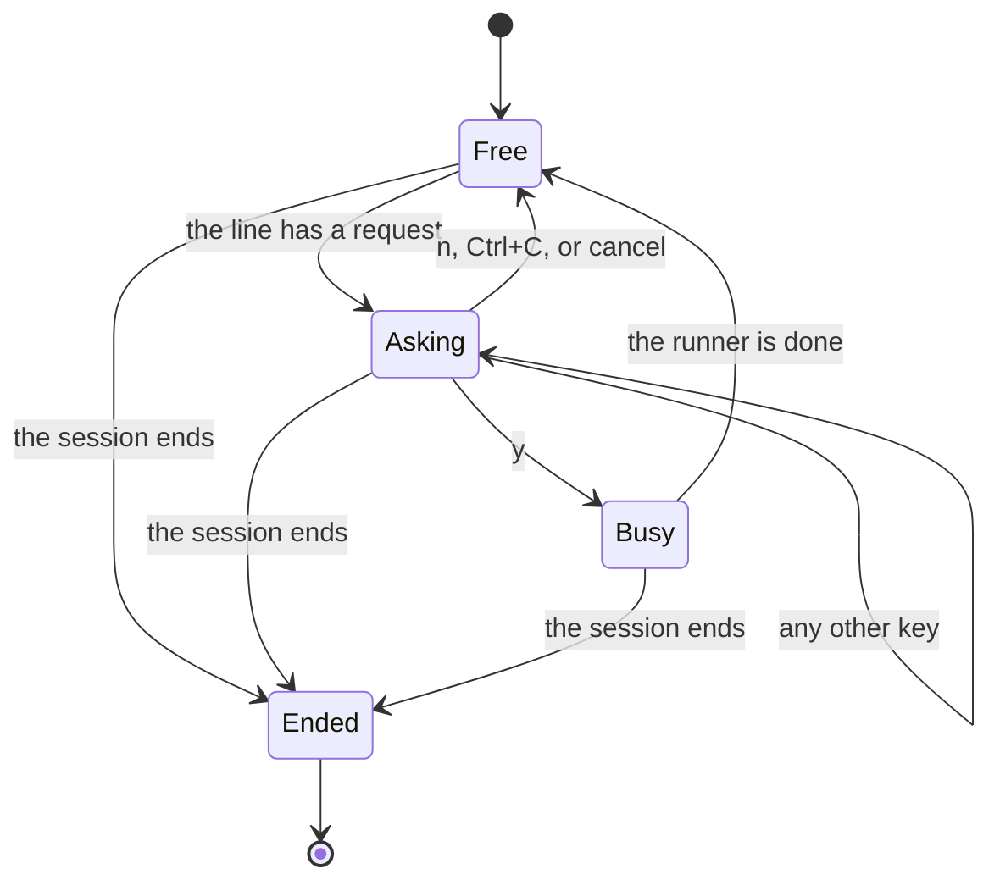

# Gangway detailed design and unit tests

The inside of each piece that has states, with the unit tests that check it. A piece is added here just before it is built. The pieces and how they fit are in `architecture.md`.

A unit test runs one piece alone. The pieces around it are fakes that record what they were asked.

## `gate`

The `gate` shows one request and takes the `y` or `n`. It is the only way to the `runner`.

### What it holds

- Its state.
- The request in front, if there is one.
- The time the prompt in front was shown.

### What it talks to

| Piece | The `gate` asks it to |
|---|---|
| `line` | Give the oldest waiting request |
| `terminal` | Show the prompt, and show the answer |
| `connection` | Send `started` or `refused` |
| `runner` | Run an approved request |
| The clock | Tell the time |

### States

| State | Meaning |
|---|---|
| `Free` | Nothing is in front |
| `Asking` | A prompt is on the screen and waits for a key |
| `Busy` | An approved request is with the `runner` |
| `Ended` | The session is over. Final |

### Events

| Event | Comes from |
|---|---|
| `ready` | `line`: a request waits. Sent when a request arrives, and asked for again each time the `gate` becomes `Free` |
| `key` | `terminal`: one key press |
| `ctrl_c` | `terminal`: one Ctrl+C |
| `cancel` | `connection`: the AI hung up on the request with this `id` |
| `done` | `runner`: the request it was given is over |
| `end` | `session`: the session ends, for any reason |

### The table

Every state meets every event. An empty "Does" means the event is dropped.

| State | Event | Does | Next |
|---|---|---|---|
| `Free` | `ready` | Takes the oldest request from `line`. Shows the prompt. Notes the time | `Asking` |
| `Free` | `key` | | `Free` |
| `Free` | `ctrl_c` | Not the gate's. `session` ends the session | `Free` |
| `Free` | `cancel` | Not the gate's. `line` removes the request if it waits | `Free` |
| `Free` | `done` | | `Free` |
| `Free` | `end` | | `Ended` |
| `Asking` | `ready` | | `Asking` |
| `Asking` | any `key`, less than `PROMPT_MIN_SHOW` after the prompt was shown | | `Asking` |
| `Asking` | `key` `y` | Shows the answer. Sends `started`. Hands the request to `runner` | `Busy` |
| `Asking` | `key` `n` | Shows the answer. Sends `refused` with `user` | `Free` |
| `Asking` | any other `key` | | `Asking` |
| `Asking` | `ctrl_c` | Shows the answer. Sends `refused` with `user` | `Free` |
| `Asking` | `cancel`, the `id` in front | Shows that the AI left. Sends `refused` with `ai_gone` | `Free` |
| `Asking` | `cancel`, another `id` | Not the gate's | `Asking` |
| `Asking` | `done` | | `Asking` |
| `Asking` | `end` | Sends `refused` with `session_ended` | `Ended` |
| `Busy` | `ready` | | `Busy` |
| `Busy` | `key` | | `Busy` |
| `Busy` | `ctrl_c` | Not the gate's. `runner` kills the command | `Busy` |
| `Busy` | `cancel` | Not the gate's. `runner` kills the command if the `id` is its own | `Busy` |
| `Busy` | `done` | | `Free` |
| `Busy` | `end` | Not the gate's. `runner` stops the command | `Ended` |
| `Ended` | any | | `Ended` |

Each time the `gate` becomes `Free`, it asks `line` whether a request waits. If one does, that is a `ready`.

### Rules the code must keep

- **One way to the runner.** The `runner` starts a request only when it is handed an approval. Only the `gate` can make an approval, and it makes one in a single place: `Asking` with `key` `y`. No other code can build one. (`GATE-01`, `GATE-07`)
- **What was shown is what runs.** The approval carries the request itself, the same value the prompt was drawn from. The `runner` runs what is in the approval and takes the request from nowhere else. (`GATE-05`)
- **An approval works once.** It names one request, and the `runner` refuses it a second time.
- **A key is never kept.** A `key` that does not answer a prompt is dropped at once. Nothing stores it for a later prompt. (`GATE-04`)
- **Exactly two keys answer.** The key must be the single byte `y` or the single byte `n`. Capitals, Enter, and every key that sends more than one byte are other keys. (`GATE-03`)
- **A fresh prompt takes no key.** A `key` that comes less than `PROMPT_MIN_SHOW` after the prompt was shown is dropped, `y` and `n` too. `ctrl_c` is not held back: it can only refuse. (`GATE-14`)
- **One answer for each request.** Every request the `gate` takes ends with one `started` or one `refused` from it, never both and never none.

The session's clock is not in the MVP. When it is built, it adds one event, "the time is up", to this table.

### Unit tests

Start: a `gate` with a fake `line`, `terminal`, `connection` and `runner`, and a clock the test moves. In a test that starts in `Asking`, `PROMPT_MIN_SHOW` has passed unless the test says otherwise.

| Test | Start | Action | Expect |
|---|---|---|---|
| UNIT-GATE-01 | `Free`, one request in the line | `ready` | `Asking`. The prompt holds the request's exact text. The runner was not called |
| UNIT-GATE-02 | `Asking` | `key` `y` | `Busy`. `started` was sent. The runner got an approval that holds the same request as the prompt |
| UNIT-GATE-03 | `Asking` | `key` `n` | `Free`. `refused` with `user`. The runner was not called |
| UNIT-GATE-04 | `Asking` | In turn: `Y`, `N`, Enter, space, Escape, an arrow key, `x` | Still `Asking` after each one. Nothing was shown, sent or run |
| UNIT-GATE-05 | `Asking` | `ctrl_c` | `Free`. `refused` with `user`. The runner was not called |
| UNIT-GATE-06 | `Asking`, request A in front | `cancel` for A | `Free`. `refused` with `ai_gone`. The runner was not called |
| UNIT-GATE-07 | `Asking`, request A in front | `cancel` for B | Still `Asking`, with A in front. Nothing was sent |
| UNIT-GATE-08 | `Asking` | `end` | `Ended`. `refused` with `session_ended`. The runner was not called |
| UNIT-GATE-09 | `Free`, the line is empty | `key` `y`, then a request arrives and `ready` | `Asking`. The early `y` did not answer it |
| UNIT-GATE-10 | `Busy` | `key` `y`, then `done`, with a second request in the line | `Asking` for the second request. The `y` did not answer it |
| UNIT-GATE-11 | `Busy`, a second request in the line | `ready` | Still `Busy`. No second prompt. The line still holds the request |
| UNIT-GATE-12 | `Asking`, a second request in the line | `key` `n`, twice with no time between | `refused` for the first, then `Asking` for the second. The second `n` did not answer it |
| UNIT-GATE-13 | `Busy`, the line is empty | `done` | `Free`. No prompt |
| UNIT-GATE-14 | `Ended` | Each event in turn | Still `Ended`. Nothing was shown, sent or run |
| UNIT-GATE-15 | Each state in turn | Each event in turn, except `key` `y` in `Asking` | The runner was never called |
| UNIT-GATE-16 | `Free` | A long run of events picked at random | The runner was called exactly as many times as `key` `y` came in `Asking`, each time with the request that was in front. Every request taken got one `started` or one `refused` |
| UNIT-GATE-17 | An approval that the runner has used | The same approval is handed to the runner again | The runner refuses it. Nothing runs |
| UNIT-GATE-18 | `Asking`, the prompt just shown | `key` `y`, then `key` `n`, with no time passed | Still `Asking`. Nothing was sent or run |
| UNIT-GATE-19 | State after UNIT-GATE-18 | The clock moves by `PROMPT_MIN_SHOW`. `key` `y` | `Busy`. The runner got the approval |
| UNIT-GATE-20 | `Asking`, the prompt just shown | `ctrl_c`, with no time passed | `Free`. `refused` with `user` |
| UNIT-GATE-21 | `Asking` for A, B in the line | `cancel` for A, then `key` `y` with no time passed | `Asking` for B. The runner was not called |
