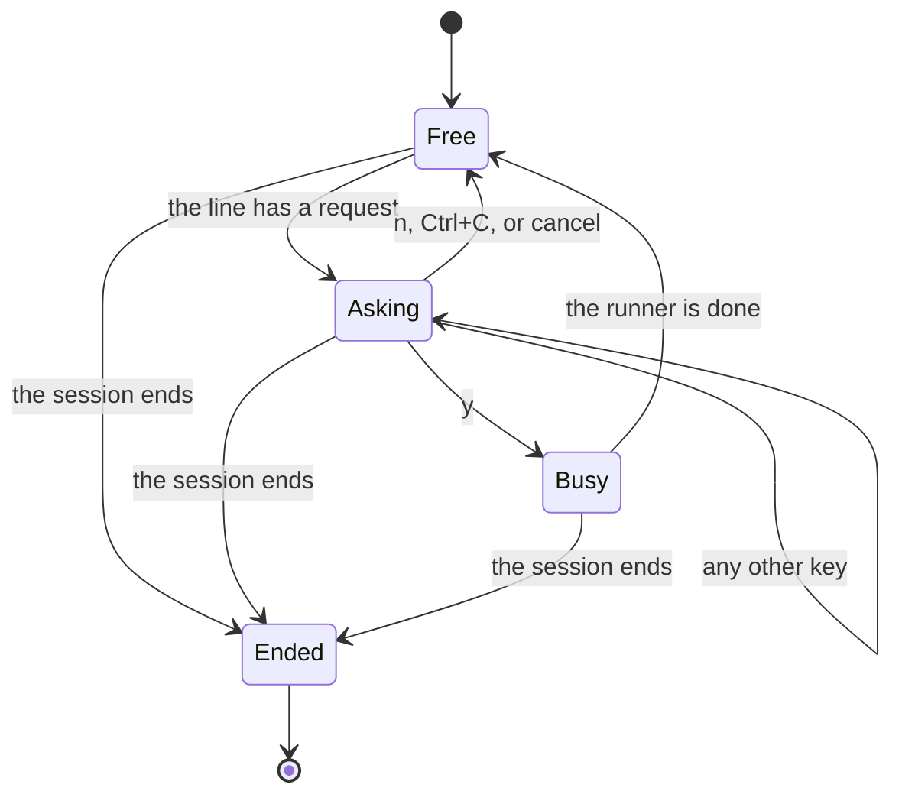

# Gangway detailed design and unit tests

The inside of each piece, with the unit tests that check it. A piece is added here just before it is built. The pieces and how they fit are in `architecture.md`.

A unit test runs one piece alone. The pieces around it are fakes that record what they were asked.

Each unit test names the requirements it helps to prove. The Go test carries the same line in a comment, and a Go test fails when the two differ or when an ID is not in `requirements.md`.

## `gate`

The `gate` shows one request and takes the `y` or `n`. It is the only way to the `runner`.

### What it holds

- Its state.
- The request in front, if there is one.
- The time the prompt in front was shown.

### What it talks to

| Piece | The `gate` asks it to |
|---|---|
| `line` | Give the oldest waiting request |
| `terminal` | Show the prompt, and show the answer |
| `connection` | Send `started` or `refused` |
| `runner` | Run an approved request |
| The clock | Tell the time |

### States

| State | Meaning |
|---|---|
| `Free` | Nothing is in front |
| `Asking` | A prompt is on the screen and waits for a key |
| `Busy` | An approved request is with the `runner` |
| `Ended` | The session is over. Final |

### Events

| Event | Comes from |
|---|---|
| `ready` | `line`: a request waits. Sent when a request arrives, and asked for again each time the `gate` becomes `Free` |
| `key` | `terminal`: one key press |
| `ctrl_c` | `terminal`: one Ctrl+C |
| `cancel` | `connection`: the AI hung up on the request with this `id` |
| `done` | `runner`: the request it was given is over |
| `end` | `session`: the session ends, for any reason |

### The table

Every state meets every event. An empty "Does" means the event is dropped.

| State | Event | Does | Next |
|---|---|---|---|
| `Free` | `ready` | Takes the oldest request from `line`. Shows the prompt. Notes the time | `Asking` |
| `Free` | `key` | | `Free` |
| `Free` | `ctrl_c` | Not the gate's. `session` ends the session | `Free` |
| `Free` | `cancel` | Not the gate's. `line` removes the request if it waits | `Free` |
| `Free` | `done` | | `Free` |
| `Free` | `end` | | `Ended` |
| `Asking` | `ready` | | `Asking` |
| `Asking` | any `key`, less than `PROMPT_MIN_SHOW` after the prompt was shown | | `Asking` |
| `Asking` | `key` `y` | Shows the answer. Sends `started`. Hands the request to `runner` | `Busy` |
| `Asking` | `key` `n` | Shows the answer. Sends `refused` with `user` | `Free` |
| `Asking` | any other `key` | | `Asking` |
| `Asking` | `ctrl_c` | Shows the answer. Sends `refused` with `user` | `Free` |
| `Asking` | `cancel`, the `id` in front | Shows that the AI left. Sends `refused` with `ai_gone` | `Free` |
| `Asking` | `cancel`, another `id` | Not the gate's | `Asking` |
| `Asking` | `done` | | `Asking` |
| `Asking` | `end` | Sends `refused` with `session_ended` | `Ended` |
| `Busy` | `ready` | | `Busy` |
| `Busy` | `key` | | `Busy` |
| `Busy` | `ctrl_c` | Not the gate's. `runner` kills the command | `Busy` |
| `Busy` | `cancel` | Not the gate's. `runner` kills the command if the `id` is its own | `Busy` |
| `Busy` | `done` | | `Free` |
| `Busy` | `end` | Not the gate's. `runner` stops the command | `Ended` |
| `Ended` | any | | `Ended` |

Each time the `gate` becomes `Free`, it asks `line` whether a request waits. If one does, that is a `ready`.

### Rules the code must keep

- **One way to the runner.** The `runner` starts a request only when it is handed an approval. Only the `gate` can make an approval, and it makes one in a single place: `Asking` with `key` `y`. No other code can build one. (`GATE-01`, `GATE-07`)
- **What was shown is what runs.** The approval carries the request itself, the same value the prompt was drawn from. The `runner` runs what is in the approval and takes the request from nowhere else. (`GATE-05`)
- **An approval works once.** It names one request, and the `runner` refuses it a second time. (`GATE-15`)
- **A key is never kept.** A `key` that does not answer a prompt is dropped at once. Nothing stores it for a later prompt. (`GATE-04`)
- **Exactly two keys answer.** The key must be the single byte `y` or the single byte `n`. Capitals, Enter, and every key that sends more than one byte are other keys. (`GATE-03`)
- **A fresh prompt takes no key.** A `key` that comes less than `PROMPT_MIN_SHOW` after the prompt was shown is dropped, `y` and `n` too. `ctrl_c` is not held back: it can only refuse. (`GATE-14`)
- **One answer for each request.** Every request the `gate` takes ends with one `started` or one `refused` from it, never both and never none.

The session's clock is not in the MVP. When it is built, it adds one event, "the time is up", to this table.

### Unit tests

Start: a `gate` with a fake `line`, `terminal`, `connection` and `runner`, and a clock the test moves. In a test that starts in `Asking`, `PROMPT_MIN_SHOW` has passed unless the test says otherwise.

| Test | Requirement | Start | Action | Expect |
|---|---|---|---|---|
| UNIT-GATE-01 | `GATE-01`, `GATE-05` | `Free`, one request in the line | `ready` | `Asking`. The prompt holds the request's exact text. The runner was not called |
| UNIT-GATE-02 | `GATE-01`, `GATE-05` | `Asking` | `key` `y` | `Busy`. `started` was sent. The runner got an approval that holds the same request as the prompt |
| UNIT-GATE-03 | `GATE-02` | `Asking` | `key` `n` | `Free`. `refused` with `user`. The runner was not called |
| UNIT-GATE-04 | `GATE-03` | `Asking` | In turn: `Y`, `N`, Enter, space, Escape, an arrow key, `x` | Still `Asking` after each one. Nothing was shown, sent or run |
| UNIT-GATE-05 | `LIM-09` | `Asking` | `ctrl_c` | `Free`. `refused` with `user`. The runner was not called |
| UNIT-GATE-06 | `GATE-12` | `Asking`, request A in front | `cancel` for A | `Free`. `refused` with `ai_gone`. The runner was not called |
| UNIT-GATE-07 | `GATE-12` | `Asking`, request A in front | `cancel` for B | Still `Asking`, with A in front. Nothing was sent |
| UNIT-GATE-08 | `GATE-01` | `Asking` | `end` | `Ended`. `refused` with `session_ended`. The runner was not called |
| UNIT-GATE-09 | `GATE-04` | `Free`, the line is empty | `key` `y`, then a request arrives and `ready` | `Asking`. The early `y` did not answer it |
| UNIT-GATE-10 | `GATE-04` | `Busy` | `key` `y`, then `done`, with a second request in the line | `Asking` for the second request. The `y` did not answer it |
| UNIT-GATE-11 | `GATE-06` | `Busy`, a second request in the line | `ready` | Still `Busy`. No second prompt. The line still holds the request |
| UNIT-GATE-12 | `GATE-02`, `GATE-06`, `GATE-14` | `Asking`, a second request in the line | `key` `n`, twice with no time between | `refused` for the first, then `Asking` for the second. The second `n` did not answer it |
| UNIT-GATE-13 | `GATE-06` | `Busy`, the line is empty | `done` | `Free`. No prompt |
| UNIT-GATE-14 | `SES-03` | `Ended` | Each event in turn | Still `Ended`. Nothing was shown, sent or run |
| UNIT-GATE-15 | `GATE-01`, `GATE-07` | Each state in turn | Each event in turn, except `key` `y` in `Asking` | The runner was never called |
| UNIT-GATE-16 | `GATE-01`, `GATE-05`, `GATE-07` | `Free` | A long run of events picked at random | The runner was called exactly as many times as `key` `y` came in `Asking`, each time with the request that was in front. Every request taken got one `started` or one `refused` |
| UNIT-GATE-17 | `GATE-15` | An approval that the runner has used | The same approval is handed to the runner again | The runner refuses it. Nothing runs |
| UNIT-GATE-18 | `GATE-14` | `Asking`, the prompt just shown | `key` `y`, then `key` `n`, with no time passed | Still `Asking`. Nothing was sent or run |
| UNIT-GATE-19 | `GATE-14` | State after UNIT-GATE-18 | The clock moves by `PROMPT_MIN_SHOW`. `key` `y` | `Busy`. The runner got the approval |
| UNIT-GATE-20 | `GATE-14`, `LIM-09` | `Asking`, the prompt just shown | `ctrl_c`, with no time passed | `Free`. `refused` with `user` |
| UNIT-GATE-21 | `GATE-12`, `GATE-14` | `Asking` for A, B in the line | `cancel` for A, then `key` `y` with no time passed | `Asking` for B. The runner was not called |

## `checks`

`checks` looks at a request before anything else does, and refuses it or lets it pass. It holds nothing and has no states: the same request always gets the same answer.

### What it refuses

A request is refused with the reason `control_character` when its text holds any of these:

| What | Which characters |
|---|---|
| A control character of the first set | Codes 0 to 31, except the line break (10) and the tab (9) |
| Delete | Code 127 |
| A control character of the second set | Codes 128 to 159 |
| Bytes that are not text | Anything that is not valid UTF-8 |

Everything else passes: letters of any language, signs, spaces, line breaks and tabs.

### Rules the code must keep

- **The whole text is read.** One bad character anywhere refuses the request: at the start, in the middle or at the end.
- **The carriage return is refused.** It moves the cursor to the start of the line, so text after it can cover the text before it.
- **The second set is refused too.** Some terminals read code 155 as the start of a cursor code, the same as Escape followed by `[`.
- **The text is never changed.** `checks` says yes or no. It does not clean a request and pass it on, because the user must approve what the AI sent, not a repaired form of it.
- **The refused text never reaches the screen.** `checks` gives back the reason only.

File reads and the protected files are not in the MVP. They add a second check here when they are built.

### Unit tests

| Test | Requirement | Start | Action | Expect |
|---|---|---|---|---|
| UNIT-CHECKS-01 | `GATE-10` | | A plain command with a pipe and a redirection | Passes |
| UNIT-CHECKS-02 | `GATE-10` | | A command of three lines with tabs | Passes |
| UNIT-CHECKS-03 | `GATE-10` | | In turn, a command that holds each code from 0 to 31, except 9 and 10 | Each is refused with `control_character` |
| UNIT-CHECKS-04 | `GATE-10` | | A command that holds code 127 | Refused |
| UNIT-CHECKS-05 | `GATE-10` | | In turn, a command that holds each code from 128 to 159 | Each is refused |
| UNIT-CHECKS-06 | `GATE-10` | | Commands that hold the written forms `\033[31m`, `\n`, `\r` and `\x1b`, made of visible characters only | Each passes |
| UNIT-CHECKS-07 | `GATE-10` | | A command that holds bytes that are not valid UTF-8 | Refused |
| UNIT-CHECKS-08 | `GATE-10` | | Commands with Greek letters, accents, an emoji and a non-breaking space | Each passes |
| UNIT-CHECKS-09 | `GATE-10` | | An Escape as the first character, in the middle, and as the last character | Each is refused |
| UNIT-CHECKS-10 | `GATE-10` | | A carriage return followed by a line break | Refused |

## `line`

The `line` holds the requests that wait for the prompt, oldest first.

### What it holds

- The waiting requests, in the order they came.
- The limit, `MAX_WAITING_REQUESTS`.

A request at the prompt has left the line, but it still waits for the user. So it counts toward the limit: with the limit at 20 and one request at the prompt, 19 more fit. A command that runs does not count.

### What it can be asked

| Ask | Does | Gives back |
|---|---|---|
| `add`, with a request and whether a prompt is on screen | Puts the request at the end, if there is room | Yes, or no when the line is full |
| `next` | Takes out the oldest request | That request, or nothing |
| `remove`, with an `id` | Takes out the request with that `id` | Yes, or no when it is not there |
| `empty` | Takes out every request | All of them, oldest first |

The `gate` asks `next`. The rest is asked by the loop: `add` for a request that passed `checks`, `remove` on a `cancel`, `empty` when the session ends. The loop then sends the `refused` for a request that did not fit, was removed, or was emptied out.

### Rules the code must keep

- **Order is never changed.** A request leaves only from the front, or by its `id`. The others keep their order.
- **A full line changes nothing.** A request that does not fit is not kept anywhere.

### Unit tests

| Test | Requirement | Start | Action | Expect |
|---|---|---|---|---|
| UNIT-LINE-01 | `GATE-06` | An empty line | `add` A, B, C. Then `next` three times | A, B, C, in that order |
| UNIT-LINE-02 | `GATE-06` | An empty line | `next` | Nothing |
| UNIT-LINE-03 | `GATE-13` | An empty line, limit 3, no prompt on screen | `add` four requests | The first three fit. The fourth does not |
| UNIT-LINE-04 | `GATE-13` | An empty line, limit 3, a prompt on screen | `add` three requests | The first two fit. The third does not |
| UNIT-LINE-05 | `GATE-13` | A full line, limit 3, no prompt on screen | `next`. Then `add` with a prompt on screen. Then `add` with no prompt on screen | The first does not fit: the request at the prompt still counts. The second fits |
| UNIT-LINE-06 | `GATE-13` | A full line | `add` one more. Then `next` until nothing comes | The same requests as before, in the same order. The one that did not fit is not among them |
| UNIT-LINE-07 | `GATE-06`, `GATE-12` | A line with A, B, C | `remove` B. Then `next` twice | Yes. Then A and C |
| UNIT-LINE-08 | `GATE-12` | A line with A, B | `remove` an `id` that is not there | No. `next` still gives A, then B |
| UNIT-LINE-09 | `SES-03` | A line with A, B, C | `empty` | A, B, C in that order. `next` gives nothing |
| UNIT-LINE-10 | `GATE-13` | Limit 1, a prompt on screen | `add` | It does not fit |
