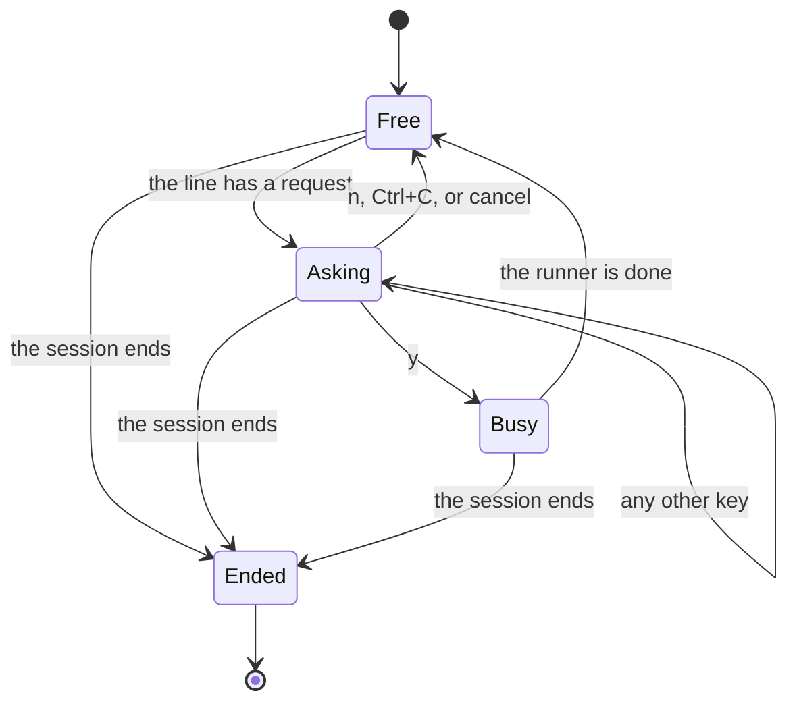
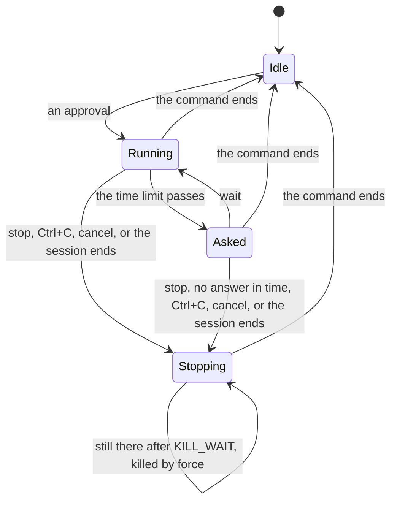

# Gangway detailed design and unit tests

The inside of each piece, with the unit tests that check it. A piece is added here just before it is built. The pieces and how they fit are in `architecture.md`.

A unit test runs one piece alone. The pieces around it are fakes that record what they were asked.

Each unit test names the requirements it helps to prove. The Go test carries the same line in a comment, and a Go test fails when the two differ or when an ID is not in `requirements.md`.

## `gate`

The `gate` shows one request and takes the `y` or `n`. It is the only way to the `runner`.

### What it holds

- Its state.
- The request in front, if there is one.
- The time the prompt in front was shown.

### What it talks to

| Piece | The `gate` asks it to |
|---|---|
| `line` | Give the oldest waiting request |
| `terminal` | Show the prompt, and show the answer |
| `connection` | Send `started` or `refused` |
| `runner` | Run an approved request |
| The clock | Tell the time |

### States

| State | Meaning |
|---|---|
| `Free` | Nothing is in front |
| `Asking` | A prompt is on the screen and waits for a key |
| `Busy` | An approved request is with the `runner` |
| `Ended` | The session is over. Final |

### Events

| Event | Comes from |
|---|---|
| `ready` | `line`: a request waits. Sent when a request arrives, and asked for again each time the `gate` becomes `Free` |
| `key` | `terminal`: one key press |
| `ctrl_c` | `terminal`: one Ctrl+C |
| `cancel` | `connection`: the AI hung up on the request with this `id` |
| `done` | `runner`: the request it was given is over |
| `end` | `session`: the session ends, for any reason |

### The table

Every state meets every event. An empty "Does" means the event is dropped.

| State | Event | Does | Next |
|---|---|---|---|
| `Free` | `ready` | Takes the oldest request from `line`. Shows the prompt. Notes the time | `Asking` |
| `Free` | `key` | | `Free` |
| `Free` | `ctrl_c` | Not the gate's. `session` ends the session | `Free` |
| `Free` | `cancel` | Not the gate's. `line` removes the request if it waits | `Free` |
| `Free` | `done` | | `Free` |
| `Free` | `end` | | `Ended` |
| `Asking` | `ready` | | `Asking` |
| `Asking` | any `key`, less than `PROMPT_MIN_SHOW` after the prompt was shown | | `Asking` |
| `Asking` | `key` `y` | Shows the answer. Sends `started`. Hands the request to `runner` | `Busy` |
| `Asking` | `key` `n` | Shows the answer. Sends `refused` with `user` | `Free` |
| `Asking` | any other `key` | | `Asking` |
| `Asking` | `ctrl_c` | Shows the answer. Sends `refused` with `user` | `Free` |
| `Asking` | `cancel`, the `id` in front | Shows that the AI left. Sends `refused` with `ai_gone` | `Free` |
| `Asking` | `cancel`, another `id` | Not the gate's | `Asking` |
| `Asking` | `done` | | `Asking` |
| `Asking` | `end` | Sends `refused` with `session_ended` | `Ended` |
| `Busy` | `ready` | | `Busy` |
| `Busy` | `key` | | `Busy` |
| `Busy` | `ctrl_c` | Not the gate's. `runner` kills the command | `Busy` |
| `Busy` | `cancel` | Not the gate's. `runner` kills the command if the `id` is its own | `Busy` |
| `Busy` | `done` | | `Free` |
| `Busy` | `end` | Not the gate's. `runner` stops the command | `Ended` |
| `Ended` | any | | `Ended` |

Each time the `gate` becomes `Free`, it asks `line` whether a request waits. If one does, that is a `ready`.

### Rules the code must keep

- **One way to the runner.** The `runner` starts a request only when it is handed an approval. Only the `gate` can make an approval, and it makes one in a single place: `Asking` with `key` `y`. No other code can build one. (`GATE-01`, `GATE-07`)
- **What was shown is what runs.** The approval carries the request itself, the same value the prompt was drawn from. The `runner` runs what is in the approval and takes the request from nowhere else. (`GATE-05`)
- **An approval works once.** It names one request, and the `runner` refuses it a second time. (`GATE-15`)
- **A key is never kept.** A `key` that does not answer a prompt is dropped at once. Nothing stores it for a later prompt. (`GATE-04`)
- **Exactly two keys answer.** The key must be the single byte `y` or the single byte `n`. Capitals, Enter, and every key that sends more than one byte are other keys. (`GATE-03`)
- **A fresh prompt takes no key.** A `key` that comes less than `PROMPT_MIN_SHOW` after the prompt was shown is dropped, `y` and `n` too. `ctrl_c` is not held back: it can only refuse. (`GATE-14`)
- **One answer for each request.** Every request the `gate` takes ends with one `started` or one `refused` from it, never both and never none.

The session's clock is not in the MVP. When it is built, it adds one event, "the time is up", to this table.

### Unit tests

Start: a `gate` with a fake `line`, `terminal`, `connection` and `runner`, and a clock the test moves. In a test that starts in `Asking`, `PROMPT_MIN_SHOW` has passed unless the test says otherwise.

| Test | Requirement | Start | Action | Expect |
|---|---|---|---|---|
| UNIT-GATE-01 | `GATE-01`, `GATE-05` | `Free`, one request in the line | `ready` | `Asking`. The prompt holds the request's exact text. The runner was not called |
| UNIT-GATE-02 | `GATE-01`, `GATE-05` | `Asking` | `key` `y` | `Busy`. `started` was sent. The runner got an approval that holds the same request as the prompt |
| UNIT-GATE-03 | `GATE-02` | `Asking` | `key` `n` | `Free`. `refused` with `user`. The runner was not called |
| UNIT-GATE-04 | `GATE-03` | `Asking` | In turn: `Y`, `N`, Enter, space, Escape, an arrow key, `x` | Still `Asking` after each one. Nothing was shown, sent or run |
| UNIT-GATE-05 | `LIM-09` | `Asking` | `ctrl_c` | `Free`. `refused` with `user`. The runner was not called |
| UNIT-GATE-06 | `GATE-12` | `Asking`, request A in front | `cancel` for A | `Free`. `refused` with `ai_gone`. The runner was not called |
| UNIT-GATE-07 | `GATE-12` | `Asking`, request A in front | `cancel` for B | Still `Asking`, with A in front. Nothing was sent |
| UNIT-GATE-08 | `GATE-01` | `Asking` | `end` | `Ended`. `refused` with `session_ended`. The runner was not called |
| UNIT-GATE-09 | `GATE-04` | `Free`, the line is empty | `key` `y`, then a request arrives and `ready` | `Asking`. The early `y` did not answer it |
| UNIT-GATE-10 | `GATE-04` | `Busy` | `key` `y`, then `done`, with a second request in the line | `Asking` for the second request. The `y` did not answer it |
| UNIT-GATE-11 | `GATE-06` | `Busy`, a second request in the line | `ready` | Still `Busy`. No second prompt. The line still holds the request |
| UNIT-GATE-12 | `GATE-02`, `GATE-06`, `GATE-14` | `Asking`, a second request in the line | `key` `n`, twice with no time between | `refused` for the first, then `Asking` for the second. The second `n` did not answer it |
| UNIT-GATE-13 | `GATE-06` | `Busy`, the line is empty | `done` | `Free`. No prompt |
| UNIT-GATE-14 | `SES-03` | `Ended` | Each event in turn | Still `Ended`. Nothing was shown, sent or run |
| UNIT-GATE-15 | `GATE-01`, `GATE-07` | Each state in turn | Each event in turn, except `key` `y` in `Asking` | The runner was never called |
| UNIT-GATE-16 | `GATE-01`, `GATE-05`, `GATE-07` | `Free` | A long run of events picked at random | The runner was called exactly as many times as `key` `y` came in `Asking`, each time with the request that was in front. Every request taken got one `started` or one `refused` |
| UNIT-GATE-17 | `GATE-15` | An approval that the runner has used | The same approval is handed to the runner again | The runner refuses it. Nothing runs |
| UNIT-GATE-18 | `GATE-14` | `Asking`, the prompt just shown | `key` `y`, then `key` `n`, with no time passed | Still `Asking`. Nothing was sent or run |
| UNIT-GATE-19 | `GATE-14` | State after UNIT-GATE-18 | The clock moves by `PROMPT_MIN_SHOW`. `key` `y` | `Busy`. The runner got the approval |
| UNIT-GATE-20 | `GATE-14`, `LIM-09` | `Asking`, the prompt just shown | `ctrl_c`, with no time passed | `Free`. `refused` with `user` |
| UNIT-GATE-21 | `GATE-12`, `GATE-14` | `Asking` for A, B in the line | `cancel` for A, then `key` `y` with no time passed | `Asking` for B. The runner was not called |

## `checks`

`checks` looks at a request before anything else does, and refuses it or lets it pass. It holds nothing and has no states: the same request always gets the same answer.

### What it refuses

A request is refused with the reason `control_character` when its text holds any of these:

| What | Which characters |
|---|---|
| A control character of the first set | Codes 0 to 31, except the line break (10) and the tab (9) |
| Delete | Code 127 |
| A control character of the second set | Codes 128 to 159 |
| Bytes that are not text | Anything that is not valid UTF-8 |
| A character that changes the reading order | The marks that turn text right to left or back, such as codes 8234 to 8238 and 8294 to 8297 |
| An invisible character | The zero-width space and joiners, the soft hyphen, the byte order mark, the invisible tag characters, and the line and paragraph separators (8232, 8233) |

In Unicode terms the last two rows are the whole "format" class, plus the two separators. The code refuses the class, not a list of its own, so a new character of that class is refused too.

Everything else passes: letters of any language, signs, spaces, line breaks and tabs.

The cost: an emoji built from joined parts, such as a family, holds an invisible joiner and is refused. A plain emoji passes.

### Rules the code must keep

- **The whole text is read.** One bad character anywhere refuses the request: at the start, in the middle or at the end.
- **The carriage return is refused.** It moves the cursor to the start of the line, so text after it can cover the text before it.
- **The second set is refused too.** Some terminals read code 155 as the start of a cursor code, the same as Escape followed by `[`.
- **What the prompt shows must be what runs.** A mark that turns the reading order around makes the screen show the characters in another order than the shell gets them. An invisible character makes two different commands look the same. (`GATE-16`)
- **The text is never changed.** `checks` says yes or no. It does not clean a request and pass it on, because the user must approve what the AI sent, not a repaired form of it.
- **The refused text never reaches the screen.** `checks` gives back the reason only.

File reads and the protected files are not in the MVP. They add a second check here when they are built.

### Unit tests

| Test | Requirement | Start | Action | Expect |
|---|---|---|---|---|
| UNIT-CHECKS-01 | `GATE-10` | | A plain command with a pipe and a redirection | Passes |
| UNIT-CHECKS-02 | `GATE-10` | | A command of three lines with tabs | Passes |
| UNIT-CHECKS-03 | `GATE-10` | | In turn, a command that holds each code from 0 to 31, except 9 and 10 | Each is refused with `control_character` |
| UNIT-CHECKS-04 | `GATE-10` | | A command that holds code 127 | Refused |
| UNIT-CHECKS-05 | `GATE-10` | | In turn, a command that holds each code from 128 to 159 | Each is refused |
| UNIT-CHECKS-06 | `GATE-10` | | Commands that hold the written forms `\033[31m`, `\n`, `\r` and `\x1b`, made of visible characters only | Each passes |
| UNIT-CHECKS-07 | `GATE-10` | | A command that holds bytes that are not valid UTF-8 | Refused |
| UNIT-CHECKS-08 | `GATE-10`, `GATE-16` | | Commands with Greek letters, accents, an emoji and a non-breaking space | Each passes |
| UNIT-CHECKS-09 | `GATE-10` | | An Escape as the first character, in the middle, and as the last character | Each is refused |
| UNIT-CHECKS-10 | `GATE-10` | | A carriage return followed by a line break | Refused |
| UNIT-CHECKS-11 | `GATE-16` | | In turn, a command that holds each mark that changes the reading order | Each is refused with `control_character` |
| UNIT-CHECKS-12 | `GATE-16` | | In turn, a command that holds a zero-width space, a zero-width joiner, a soft hyphen, a byte order mark and an invisible tag character | Each is refused |
| UNIT-CHECKS-13 | `GATE-16` | | A command that holds a line separator, and one that holds a paragraph separator | Each is refused |
| UNIT-CHECKS-14 | `GATE-16` | | A command with an emoji built from joined parts | Refused |

## `line`

The `line` holds the requests that wait for the prompt, oldest first.

### What it holds

- The waiting requests, in the order they came.
- The limit, `MAX_WAITING_REQUESTS`.

A request at the prompt has left the line, but it still waits for the user. So it counts toward the limit: with the limit at 20 and one request at the prompt, 19 more fit. A command that runs does not count.

### What it can be asked

| Ask | Does | Gives back |
|---|---|---|
| `add`, with a request and whether a prompt is on screen | Puts the request at the end, if there is room | Yes, or no when the line is full |
| `next` | Takes out the oldest request | That request, or nothing |
| `remove`, with an `id` | Takes out the request with that `id` | Yes, or no when it is not there |
| `empty` | Takes out every request | All of them, oldest first |

The `gate` asks `next`. The rest is asked by the loop: `add` for a request that passed `checks`, `remove` on a `cancel`, `empty` when the session ends. The loop then sends the `refused` for a request that did not fit, was removed, or was emptied out.

### Rules the code must keep

- **Order is never changed.** A request leaves only from the front, or by its `id`. The others keep their order.
- **A full line changes nothing.** A request that does not fit is not kept anywhere.

### Unit tests

| Test | Requirement | Start | Action | Expect |
|---|---|---|---|---|
| UNIT-LINE-01 | `GATE-06` | An empty line | `add` A, B, C. Then `next` three times | A, B, C, in that order |
| UNIT-LINE-02 | `GATE-06` | An empty line | `next` | Nothing |
| UNIT-LINE-03 | `GATE-13` | An empty line, limit 3, no prompt on screen | `add` four requests | The first three fit. The fourth does not |
| UNIT-LINE-04 | `GATE-13` | An empty line, limit 3, a prompt on screen | `add` three requests | The first two fit. The third does not |
| UNIT-LINE-05 | `GATE-13` | A full line, limit 3, no prompt on screen | `next`. Then `add` with a prompt on screen. Then `add` with no prompt on screen | The first does not fit: the request at the prompt still counts. The second fits |
| UNIT-LINE-06 | `GATE-13` | A full line | `add` one more. Then `next` until nothing comes | The same requests as before, in the same order. The one that did not fit is not among them |
| UNIT-LINE-07 | `GATE-06`, `GATE-12` | A line with A, B, C | `remove` B. Then `next` twice | Yes. Then A and C |
| UNIT-LINE-08 | `GATE-12` | A line with A, B | `remove` an `id` that is not there | No. `next` still gives A, then B |
| UNIT-LINE-09 | `SES-03` | A line with A, B, C | `empty` | A, B, C in that order. `next` gives nothing |
| UNIT-LINE-10 | `GATE-13` | Limit 1, a prompt on screen | `add` | It does not fit |

## `runner`

The `runner` runs one approved command, sends what it writes, asks "wait or stop" at the time limit, and kills it when told. It is in two halves:

- **The state machine.** It decides. It never touches a real program, so a test can drive it with no waiting.
- **The starter.** It starts a real program and can kill it. It decides nothing.

### What it holds

- Its state.
- The request that runs, and the handle of its program.
- How the command will be said to have ended, once a kill is sent.
- Whether any byte of the output was replaced.
- The number of the timer it waits for.

### What it talks to

| Piece | The `runner` asks it to |
|---|---|
| The starter | Start the command through the shell. Ask the program to stop. Kill it by force |
| The timers | Call back after a time |
| `terminal` | Show the output, and show how the command ended |
| `connection` | Send `output`, `still_running` and `ended` |
| `gate` | Take the next request: `done` |

### States

| State | Meaning |
|---|---|
| `Idle` | Nothing runs |
| `Running` | A command runs and its time limit counts |
| `Asked` | The time limit passed. The AI was asked to wait or stop, and the answer time counts |
| `Stopping` | The command was told to stop and has not ended yet |

### Events

| Event | Comes from |
|---|---|
| `run` | `gate`: an approval |
| `output` | The starter: the command wrote something |
| `exited` | The starter: the shell ended, with its exit code |
| `timer` | The timers: a time has passed. It carries the number it was started with |
| `wait`, `stop` | `connection`: the AI's answer |
| `ctrl_c` | `terminal`: one Ctrl+C |
| `cancel` | `connection`: the AI hung up on the request with this `id` |
| `end` | `session`: the session ends |

### The table

An empty "Does" means the event is dropped. "Kill" means: ask the program to stop, note how the command ended, and start a timer of `KILL_WAIT`.

| State | Event | Does | Next |
|---|---|---|---|
| `Idle` | `run`, the approval works | Starts the command through `COMMAND_SHELL`. Starts a timer of `COMMAND_TIME_LIMIT` | `Running` |
| `Idle` | `run`, the approval works, the start fails | Sends `ended` with `start_failed` and the reason as output. Tells `gate` `done` | `Idle` |
| `Idle` | `run`, the approval does not work | | `Idle` |
| `Idle` | any other | | `Idle` |
| `Running` | `run` | | `Running` |
| `Running` | `output` | Shows it. Sends `output` | `Running` |
| `Running` | `exited` | Sends `ended` with `exit` and the exit code. Tells `gate` `done` | `Idle` |
| `Running` | `timer`, the one it waits for | Sends `still_running`. Starts a timer of `QUESTION_WAIT` | `Asked` |
| `Running` | `wait` | | `Running` |
| `Running` | `stop` | Kill, `killed_by_ai` | `Stopping` |
| `Running` | `ctrl_c` | Kill, `killed_by_user` | `Stopping` |
| `Running` | `cancel`, its own `id` | Kill, `killed_ai_gone` | `Stopping` |
| `Running` | `cancel`, another `id` | | `Running` |
| `Running` | `end` | Kill, `killed_session_ended` | `Stopping` |
| `Asked` | `run` | | `Asked` |
| `Asked` | `output` | Shows it. Sends `output` | `Asked` |
| `Asked` | `exited` | Sends `ended` with `exit` and the exit code. Tells `gate` `done` | `Idle` |
| `Asked` | `wait` | Starts a timer of `COMMAND_TIME_LIMIT` | `Running` |
| `Asked` | `stop` | Kill, `killed_by_ai` | `Stopping` |
| `Asked` | `timer`, the one it waits for | Kill, `killed_no_answer` | `Stopping` |
| `Asked` | `ctrl_c` | Kill, `killed_by_user` | `Stopping` |
| `Asked` | `cancel`, its own `id` | Kill, `killed_ai_gone` | `Stopping` |
| `Asked` | `cancel`, another `id` | | `Asked` |
| `Asked` | `end` | Kill, `killed_session_ended` | `Stopping` |
| `Stopping` | `output` | Shows it. Sends `output` | `Stopping` |
| `Stopping` | `exited` | Kills by force what is left of the command. Sends `ended` with the noted way. Tells `gate` `done` | `Idle` |
| `Stopping` | `timer`, the one it waits for | Kills the program by force | `Stopping` |
| `Stopping` | any other | | `Stopping` |
| any | `timer`, another number | | the same |

### Rules the code must keep

- **Nothing runs without an approval that works.** The `runner` takes the request out of the approval, and from nowhere else. A used approval gives nothing. (`GATE-01`, `GATE-15`)
- **One command at a time.** A `run` outside `Idle` is dropped. (`GATE-06`)
- **Every command that starts gets one `ended`, and the `gate` one `done`.** Never two, never none.
- **The first reason to kill wins.** Once a kill is sent, a later `stop` or Ctrl+C does not change how the command is said to have ended.
- **A timer that is no longer waited for does nothing.** Each timer carries a number. The `runner` raises the number each time it starts one, and drops a `timer` event with an old number. No timer is ever cancelled.
- **The AI gets text.** Output that is not valid UTF-8 has each bad stretch replaced by the mark `�`, and `ended` then says `bytes_replaced`. A character that arrives split over two pieces is put together first and is not replaced. Nothing else in the output is changed: cleaning is for the screen only, and the `terminal` does it. (`SHOW-03`)

### The starter

- **Through the shell.** It runs `COMMAND_SHELL` with `-c` and the command as one argument, as the user who started the cli-tool. (`GATE-08`, `GATE-11`)
- **No keyboard.** The command's input is empty. (`GATE-17`)
- **Plain surroundings.** `PAGER=cat` and `TERM=dumb` are added to what the cli-tool itself was started with. (`GATE-18`)
- **Both outputs, one stream.** Normal and error output go into the same pipe, so their order is kept.
- **A group of its own.** The command starts in a new process group. A kill goes to the whole group, so every program the command started gets it. (`LIM-11`)
- **Asking, then force.** "Ask to stop" is the signal `TERM`. "Kill by force" is the signal `KILL`. (`LIM-13`)
- **Over when the shell ends.** The exit code is the shell's. A shell ended by a signal gives 128 plus the signal's number, as shells do. A program left in the background is not killed and is not waited for. Half a second after the shell ends, the starter stops reading the output, so such a program must write to a file. (`LIM-12`)

### Unit tests

Tests 01 to 20 run the state machine with a fake starter, fake timers and a fake `terminal`, `connection` and `gate`. Tests 21 to 31 run the real starter with real commands in a scratch folder.

| Test | Requirement | Start | Action | Expect |
|---|---|---|---|---|
| UNIT-RUNNER-01 | `GATE-01`, `GATE-11` | `Idle` | `run` with a fresh approval | `Running`. The starter got `COMMAND_SHELL` and the exact command. A timer of `COMMAND_TIME_LIMIT` was started |
| UNIT-RUNNER-02 | `GATE-15` | `Idle` | `run` with a used approval, and with no approval | `Idle`. Nothing was started or sent |
| UNIT-RUNNER-03 | `GATE-06` | `Running` | `run` with a second fresh approval | Nothing more was started. The second approval is still unused |
| UNIT-RUNNER-04 | `SHOW-02` | `Running` | `output` twice | The screen and the connection each got both pieces, in order |
| UNIT-RUNNER-05 | `LIM-01` | `Running` | `exited` with code 3 | `Idle`. `ended` with `exit` and 3. `gate` got `done` once. No `still_running` |
| UNIT-RUNNER-06 | `LIM-01` | `Running` | The `timer` | `Asked`. `still_running` was sent. A timer of `QUESTION_WAIT` was started. Nothing was killed |
| UNIT-RUNNER-07 | `LIM-02` | `Asked` | `wait`, then the new `timer` | `Running` after `wait`, with a new timer of `COMMAND_TIME_LIMIT`. Then `Asked` and a second `still_running` |
| UNIT-RUNNER-08 | `LIM-02` | `Asked` | `stop`, then `exited` | The program was asked to stop. Then `ended` with `killed_by_ai`, and `Idle` |
| UNIT-RUNNER-09 | `LIM-03` | `Asked` | The `timer`, then `exited` | The program was asked to stop. Then `ended` with `killed_no_answer` |
| UNIT-RUNNER-10 | `LIM-04` | `Asked` | `exited` with code 0 | `Idle`. `ended` with `exit` and 0. Nothing was killed |
| UNIT-RUNNER-11 | `LIM-08` | `Running` | `ctrl_c`, then `exited` | The program was asked to stop. `ended` with `killed_by_user`. `Idle`, and `gate` got `done` |
| UNIT-RUNNER-12 | `LIM-07` | `Running` | `cancel` for another `id`, then `cancel` for its own, then `exited` | The first does nothing. The second asks the program to stop. `ended` with `killed_ai_gone` |
| UNIT-RUNNER-13 | `SES-05` | `Running`, and again `Asked` | `end`, then `exited` | The program was asked to stop. `ended` with `killed_session_ended` |
| UNIT-RUNNER-14 | `LIM-02`, `LIM-03` | `Asked` | `wait`, then the old `timer` of the question. Then `exited`, then every old `timer` | The old timer kills nothing. After the end, no timer does anything |
| UNIT-RUNNER-15 | `LIM-13` | `Stopping` after `ctrl_c` | The `timer` of `KILL_WAIT` | The program was killed by force. Still `Stopping` until `exited` |
| UNIT-RUNNER-16 | `LIM-08` | `Stopping` after `ctrl_c` | `stop`, `cancel`, `end`, `ctrl_c`, then `exited` | The program was asked to stop once only. `ended` with `killed_by_user` |
| UNIT-RUNNER-17 | `LIM-02` | `Stopping` | `output`, then `exited` | The output was shown and sent before `ended` |
| UNIT-RUNNER-18 | `SHOW-03` | `Running` | `output` with a bad byte. `output` with a Greek letter split over two pieces. `output` that ends in half a letter, then `exited` | The bad byte and the half letter each came as the mark. The split letter came whole. `ended` says `bytes_replaced`. A run with clean output does not say it |
| UNIT-RUNNER-19 | `GATE-11` | `Idle`, a starter that fails | `run` with a fresh approval | `Idle`. `ended` with `start_failed`, and the reason was sent as output. `gate` got `done` |
| UNIT-RUNNER-20 | `GATE-01`, `LIM-02` | `Idle`, and `Running` | In `Idle`: every event but `run`. In `Running`: `stop` | In `Idle` nothing was started, killed or sent. In `Running`, `stop` asks the program to stop, and `ended` says `killed_by_ai` |
| UNIT-RUNNER-21 | `GATE-11` | The real starter | Two commands joined by a pipe | The output of the second, fed by the first. Exit code 0 |
| UNIT-RUNNER-22 | `GATE-11` | The real starter | A command that writes to a file with `>`, then `;`, then a second command | The file holds the text. The second command ran too |
| UNIT-RUNNER-23 | `GATE-08` | The real starter | A command that prints the user's number | The number of the user who runs the test |
| UNIT-RUNNER-24 | `GATE-01` | The real starter | `exit 7` | Exit code 7 |
| UNIT-RUNNER-25 | `SHOW-02` | The real starter | A command that writes to normal output, then error output, then normal output | All three, in that order |
| UNIT-RUNNER-26 | `GATE-17` | The real starter | `cat` with no file | It ends at once with no output and exit code 0 |
| UNIT-RUNNER-27 | `GATE-18` | The real starter | A command that prints `PAGER` and `TERM` | `cat` and `dumb` |
| UNIT-RUNNER-28 | `LIM-11` | The real starter, a command that starts a long program in the background, prints its number and waits | Ask it to stop | The shell ends, and the background program is gone |
| UNIT-RUNNER-29 | `LIM-13` | The real starter, a command that does not stop when asked | Ask it to stop. Then kill by force | It still runs after the asking. It is gone after the force |
| UNIT-RUNNER-30 | `LIM-12` | The real starter | A command that starts a long program in the background with its output to a file, prints its number, and ends. Then the same with the output not sent to a file | Both times the exit comes in under two seconds and the program still runs. The test then kills it |
| UNIT-RUNNER-31 | `GATE-11` | The real starter, a shell that is not there | Start a command | An error. No exit is reported |

## `terminal`

The `terminal` is the only piece that reads keys and writes to the screen. It is in three parts:

- **The keys.** Cuts the bytes from the keyboard into key presses, and tells one Ctrl+C from two.
- **The screen.** Writes the prompt, the answers, the output and the notes. Cleans all of it.
- **The raw mode.** Sets the real terminal so that keys come at once, and puts it back at the end.

### What it holds

- An Escape or a key of many bytes that is not over yet.
- The time of the last Ctrl+C that a second one can pair with.
- Whether the cursor is at the start of a line.
- The request whose prompt waits on screen, if one does.

### What it sends

| Event | Meaning |
|---|---|
| `key` | One key press that is not Ctrl+C, as the bytes the key sent |
| `ctrl_c` | One Ctrl+C |
| `quit` | The second of two Ctrl+C within `DOUBLE_CTRL_C_WINDOW` |

The loop passes `key` to the `gate`. It passes `ctrl_c` to whatever is in front, and `quit` ends the cli-tool.

### The keys

| Bytes | Become |
|---|---|
| Code 3 | `ctrl_c`, or `quit` |
| Escape, `[` or `O`, and all that follows up to a byte from `@` to `~` | One `key` of all those bytes: an arrow, a function key |
| Escape and one other byte | One `key` of two bytes |
| A letter of more than one byte | One `key` of those bytes |
| Any other byte | One `key` of one byte |

- **A doubt drops a key and never makes one up.** Only a `key` of the single byte `y` or `n` can answer a prompt. So when the cutting is not sure, it joins bytes into one key, which answers nothing. (`GATE-03`)
- **A key can come in two reads.** An Escape at the end of one read is joined with the start of the next.
- **Ctrl+C is never eaten.** A code 3 inside an unfinished key ends that key and still counts. (`LIM-10`)
- **Two Ctrl+C.** A Ctrl+C is `quit` when the one before it was a `ctrl_c` and came no more than `DOUBLE_CTRL_C_WINDOW` earlier. Keys pressed between the two change nothing. After a `quit`, the next Ctrl+C is a `ctrl_c` again.

### The screen

The wording is in `ux.md`.

- **Everything is cleaned.** Every character that `checks` would refuse in a request is replaced by the mark `�` before it is written: in output, and also in the command of a prompt and in notes. Line breaks and tabs stay. (`SHOW-03`, `SHOW-05`)
- **Output is marked.** Every line of a command's output starts with `  | `. No line of the cli-tool itself starts with a space. So output that copies the words of a prompt still does not look like one. (`SHOW-04`)
- **The cli-tool's lines start at the start of a line.** If output ended with no line break, a line break is written first.
- **The prompt shows the request as it is.** Each line of the command is shown on a line of its own, after `  > `. (`GATE-05`)
- **The prompt is the last thing on screen.** A note that comes while a prompt waits is written, and the prompt is then shown again under it.
- **A refusal with no prompt shows the reason only.** The screen is never handed the refused text. (`GATE-10`, `GATE-16`)

Known limit: a line of output longer than the window is folded by the terminal, and the folded part has no mark. The real prompt still comes last, under it.

### The raw mode

- Keys come one by one with no Enter, and are not shown.
- Ctrl+C comes as a key, not as a signal. So does Ctrl+Z.
- Output is left as it was, so a line break still starts a new line.
- The settings found at the start are kept and put back at the end. (`HOST-07`)

### Unit tests

Tests 01 to 10 are for the keys, 11 to 23 for the screen, with a buffer in place of the screen and a clock the test moves. Tests 24 to 27 use a real terminal that the test makes for itself.

| Test | Requirement | Start | Action | Expect |
|---|---|---|---|---|
| UNIT-TERMINAL-01 | `GATE-03` | | The bytes `yes` in one read | Three `key`: `y`, `e`, `s` |
| UNIT-TERMINAL-02 | `GATE-03` | | An arrow key, a function key and a key that starts with Escape `O`, in one read | Three `key`, each with all its bytes |
| UNIT-TERMINAL-03 | `GATE-03` | | A Greek letter and an emoji | Two `key`, each with all its bytes |
| UNIT-TERMINAL-04 | `GATE-03` | | An arrow key cut over two reads, at each place it can be cut | One `key` each time, and no other |
| UNIT-TERMINAL-05 | `GATE-03` | | Escape, then `y`, in two reads | One `key` of two bytes. No `key` is the single byte `y` |
| UNIT-TERMINAL-06 | `LIM-09` | | Code 3 | One `ctrl_c`. No `key` |
| UNIT-TERMINAL-07 | `LIM-10` | | Escape, `[`, then code 3 | One `key` for the unfinished bytes, then one `ctrl_c` |
| UNIT-TERMINAL-08 | `LIM-10` | | Two code 3: in one read, and in two reads within `DOUBLE_CTRL_C_WINDOW` | `ctrl_c`, then `quit`, both times |
| UNIT-TERMINAL-09 | `LIM-10` | | Two code 3 further apart than `DOUBLE_CTRL_C_WINDOW`. Then two exactly that far apart | Two `ctrl_c` and no `quit`. Then `ctrl_c` and `quit` |
| UNIT-TERMINAL-10 | `LIM-10` | | Code 3, then `x`, then code 3, within the window. Then a fourth code 3 at once | `ctrl_c`, `key`, `quit`. Then `ctrl_c`, not a second `quit` |
| UNIT-TERMINAL-11 | `SHOW-01`, `GATE-05` | | A prompt for a command | The screen shows the exact command after `  > `, then the question. The cursor stays on the question's line |
| UNIT-TERMINAL-12 | `GATE-05` | | A prompt for a command of three lines with a tab | Three lines, each after `  > `, with the tab as it is |
| UNIT-TERMINAL-13 | `SHOW-01` | A prompt on screen | The answer: yes, no, and "the AI left" | `y`, `n`, and a line that says the AI hung up and nothing ran. Each ends its line |
| UNIT-TERMINAL-14 | `SHOW-02` | | Output of two lines, then the end with exit code 0. Again with exit code 3 | Both lines, then a line with the exit code |
| UNIT-TERMINAL-15 | `SHOW-02` | | The end, for each way a command can end | A line for each. No two are the same |
| UNIT-TERMINAL-16 | `SHOW-03` | | Output with an Escape, a colour code, a carriage return, a bell, a backspace, a zero byte, code 127 and code 155 | None of them is written. A mark stands in each place. Line breaks and tabs are written |
| UNIT-TERMINAL-17 | `SHOW-05` | | Output with a character that turns the reading order around, and a zero-width space | Neither is written. A mark stands in each place |
| UNIT-TERMINAL-18 | `SHOW-04` | | Output of many lines in one piece. A line that comes in two pieces. Output that copies a prompt | Every line starts with `  | `, once. No line starts with the words of a prompt |
| UNIT-TERMINAL-19 | `SHOW-04` | Output that ended with no line break | The end of the command. Again with a new prompt | What the cli-tool writes starts on a new line |
| UNIT-TERMINAL-20 | `SHOW-01` | | A refusal with no prompt, for a control character and for a full line | A line each, that says a request was refused and why |
| UNIT-TERMINAL-21 | `SHOW-01` | A prompt on screen | A refusal with no prompt | The note, then the same prompt again as the last thing on screen |
| UNIT-TERMINAL-22 | `KEY-04` | | The paste line for an address and a key | A line that is exactly `/gangway`, the address and the key, with one space between |
| UNIT-TERMINAL-23 | `SHOW-03` | | A prompt, a note and a paste line that hold an Escape | No Escape is written |
| UNIT-TERMINAL-24 | `GATE-03` | A real terminal in raw mode | `y` is typed with no Enter | The `y` can be read at once |
| UNIT-TERMINAL-25 | `LIM-09` | A real terminal in raw mode | Ctrl+C is typed | Code 3 can be read |
| UNIT-TERMINAL-26 | `HOST-02` | | Ask whether a real terminal is a terminal. Ask the same of a plain file | Yes. No |
| UNIT-TERMINAL-27 | `HOST-07` | A real terminal in raw mode | Put it back | Its settings are the ones found at the start |
