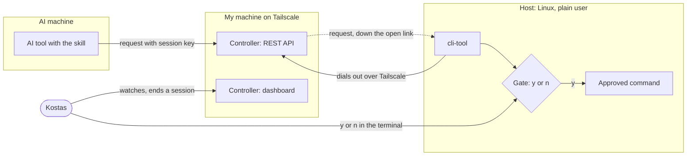
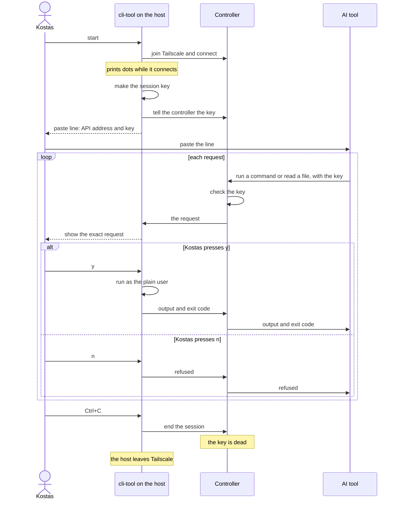
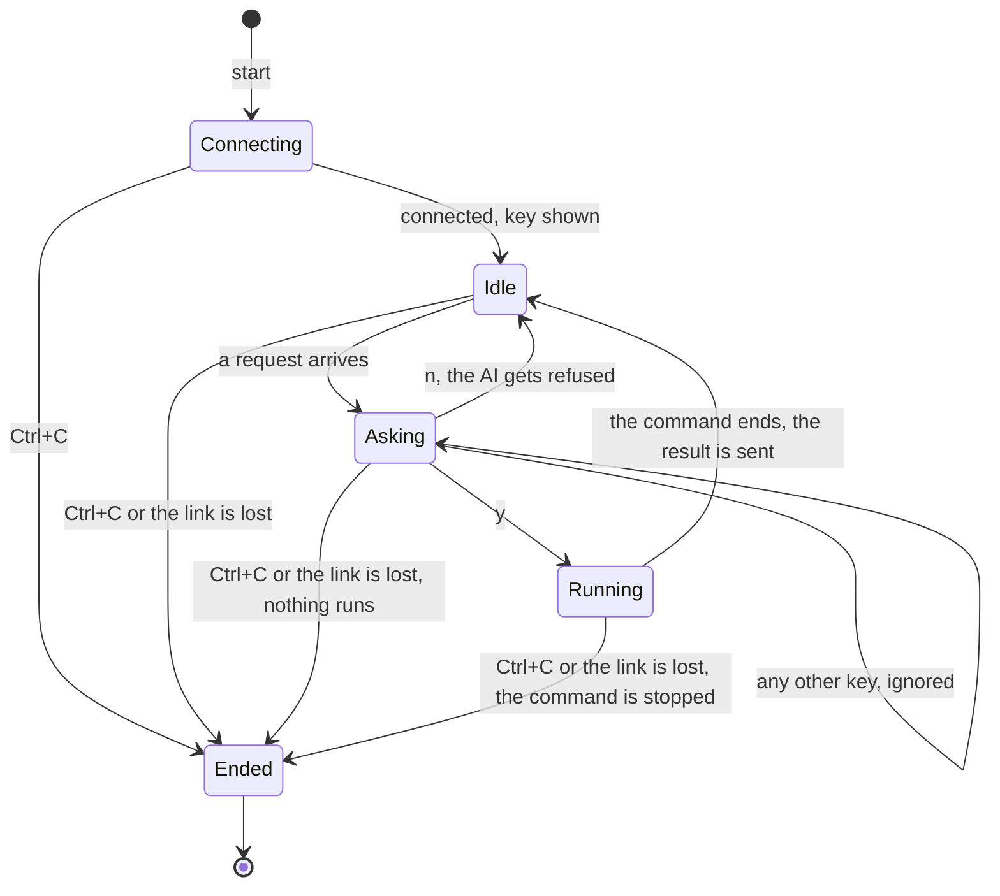
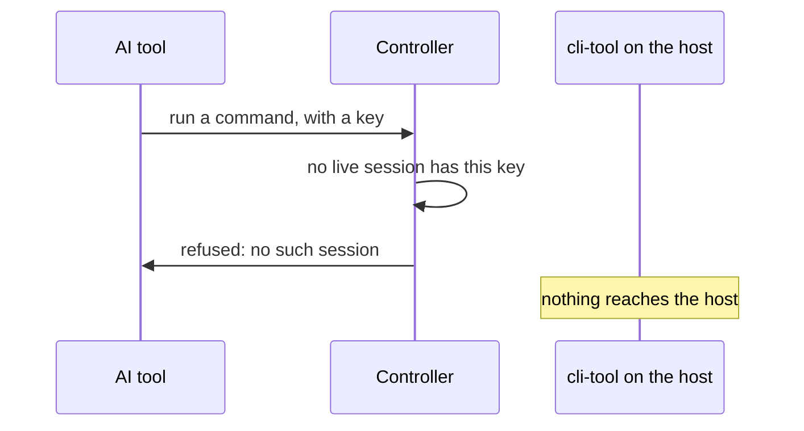
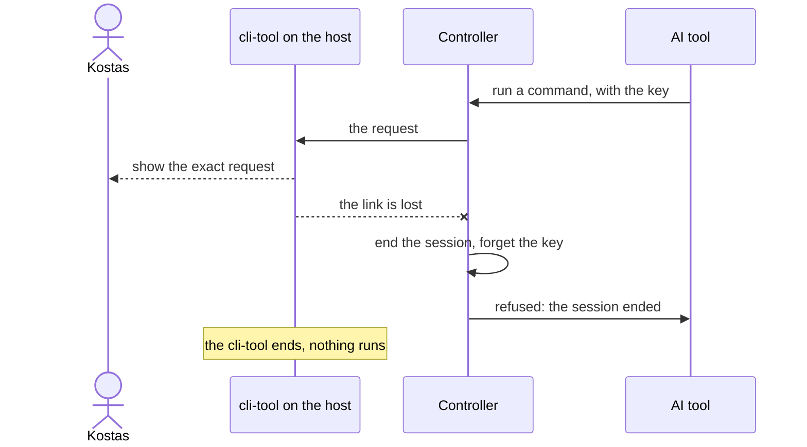
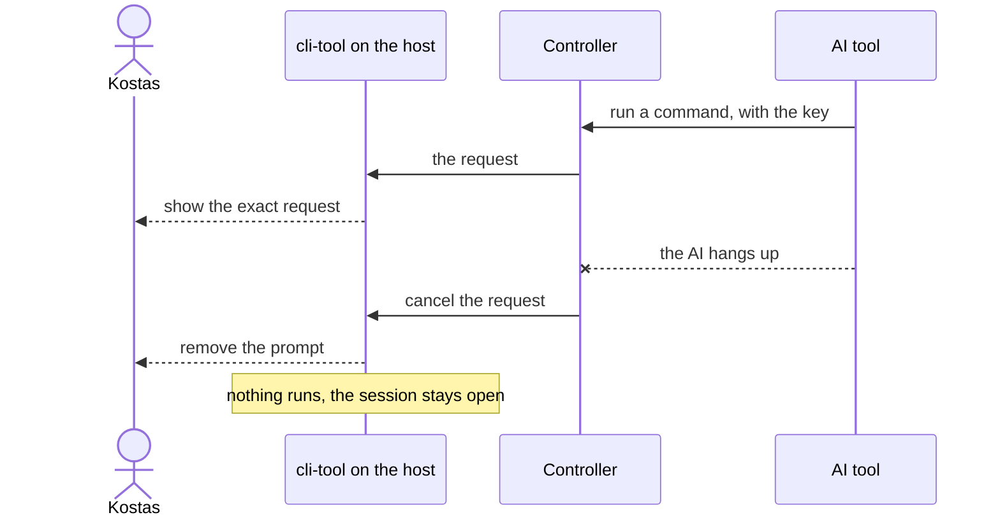
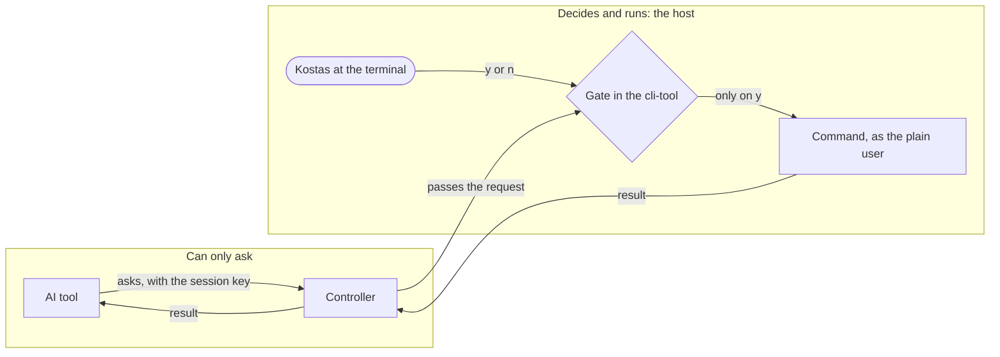

# Gangway diagrams

These show the first version as `blueprint.md` describes it. The MVP is the same flow on one machine, with no Tailscale yet.

## 1. Parts

Where each part runs and who starts each connection. An arrow points from the side that dials to the side that listens.

The host listens on nothing. The dotted arrow is not a new connection: the request travels down the link the cli-tool opened.

## 2. One session

## 3. The gate

The states of the cli-tool during a session.

- Only `y` in the Asking state leads to Running. There is no other way in.
- A key pressed in Idle or Running is thrown away. It does not answer the next request.
- A request that arrives in Asking or Running waits in line. Requests are asked one at a time, in order.
- Ended is final. There is no resume.

## 4. When things go wrong

### 4a. No live session for the key

The key is wrong, or the session has ended. The controller cannot tell these apart and does not need to.

### 4b. The host drops while a prompt waits

### 4c. The AI hangs up while a prompt waits

## 5. Trust

Who can only ask, and who decides.

| If this is taken over | It can | It cannot |
|---|---|---|
| The AI tool | Ask for harmful commands. Read every result it asked for | Run anything without a `y` |
| A stolen session key | Ask, until the session ends | Run anything without a `y` |
| The controller | Ask. Read every result that passes through it. Drop or change a result on its way to the AI | Run anything without a `y`. Change what the prompt shows: the host shows the request it got and runs exactly that |

## For the reviewer

Three points the diagrams had to assume. Each one is open.

1. **The link.** The diagrams show one open link from the cli-tool to the controller, with requests pushed down it. I assumed a websocket.
2. **The key on the controller.** Diagram 2 has the cli-tool tell the controller the key. The controller could keep only a hash of it, so a memory dump of the controller does not give a usable key.
3. **The AI hangs up while a command runs.** Diagram 4c covers a waiting prompt only. For a running command I assumed it runs to the end and the result is dropped. The other choice is to stop the command.
