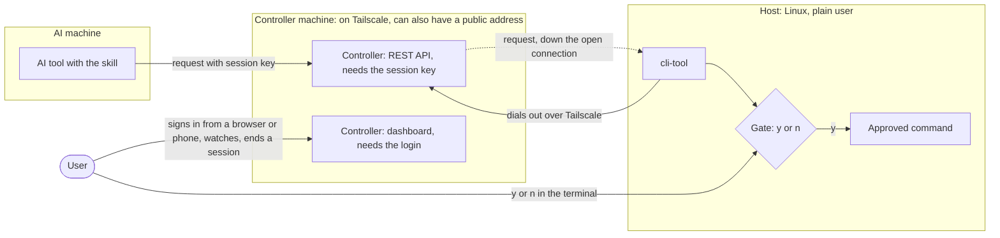
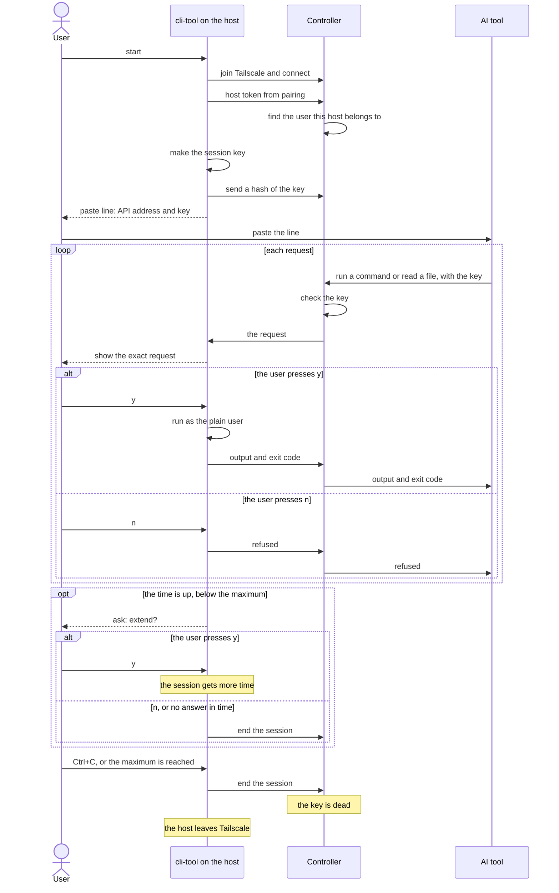
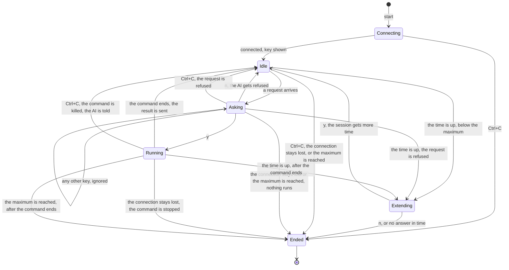
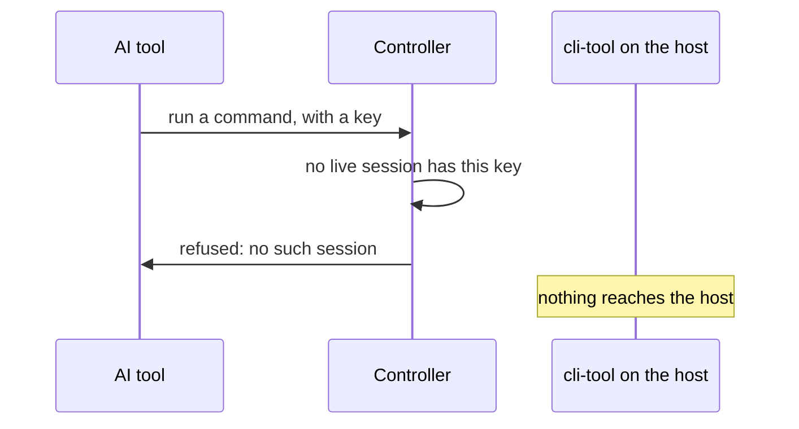
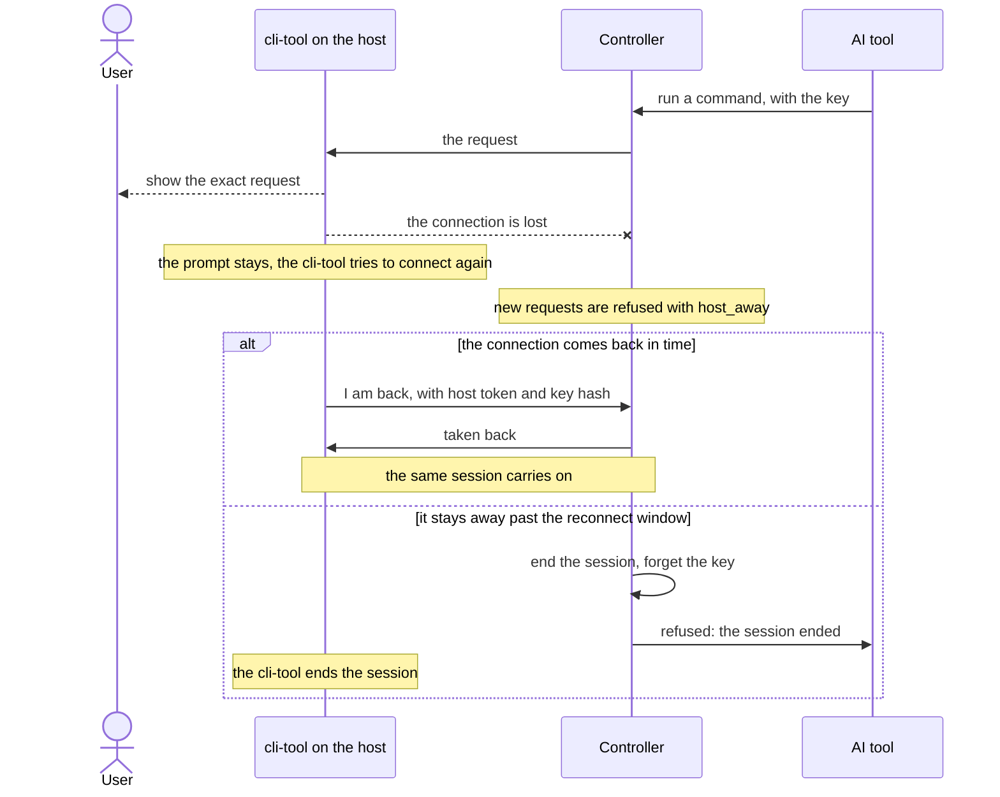
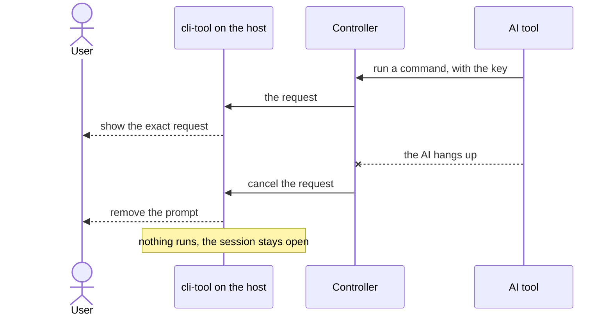
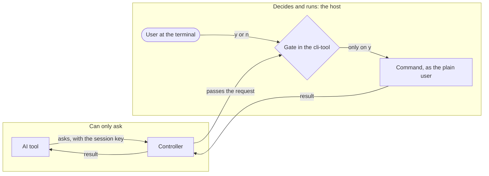
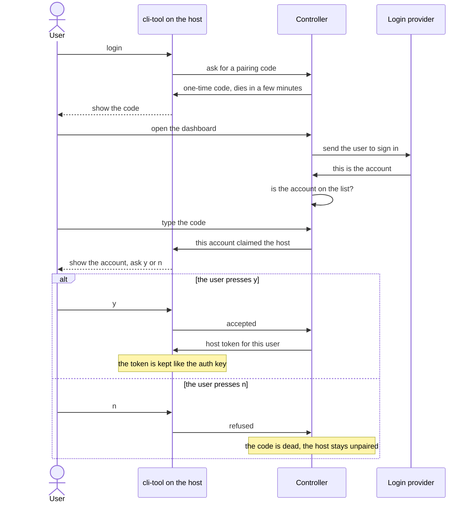

# Gangway diagrams

These show the design as `blueprint.md` describes it. The one-machine mode is the same flow with no Tailscale.

## 1. Parts

Where each part runs and who starts each connection. An arrow points from the side that dials to the side that listens.

The host listens on nothing and reaches the controller over Tailscale only. The AI, the browser and the phone reach the controller on its own address, which can be public. The dotted arrow is not a new connection: the request travels down the link the cli-tool opened.

## 2. One session

## 3. The gate

The states of the cli-tool during a session.

- Only `y` in the Asking state leads to Running. There is no other way in.
- A key pressed in the first moment after a prompt is shown is thrown away too.
- A key pressed in Idle or Running is thrown away. It does not answer the next request.
- A request that arrives in Asking or Running waits in line. Requests are asked one at a time, in order.
- Extending is the question "extend?" when the session's time is up. Only the user at the terminal can answer it.
- When the time is up or the maximum is reached, a running command is not killed. It may finish, but it gets no more "wait more", so it is killed at its next time limit. New requests are refused from that moment.
- Two Ctrl+C close together lead to Ended from any state. The diagram leaves those arrows out to stay readable.
- "The connection stays lost" means it did not come back within the reconnect window. A shorter loss changes no state.
- Ended is final. There is no resume.

## 4. When things go wrong

### 4a. No live session for the key

The key is wrong, or the session has ended. The controller cannot tell these apart and does not need to.

### 4b. The connection is lost while a prompt waits

### 4c. The AI hangs up while a prompt waits

If the AI hangs up while a command runs, the cli-tool kills the command. The session stays open.

## 5. Trust

Who can only ask, and who decides.

| If this is taken over | It can | It cannot |
|---|---|---|
| The AI tool | Ask for harmful commands. Read every result it asked for | Run anything without a `y` |
| A stolen session key | Ask, until the session ends | Run anything without a `y` |
| The login of a user | See that user's sessions and results in the dashboard. End that user's sessions | Run anything without a `y`. Sign in at all, unless the account is on the list |
| The controller | Ask. Read every result that passes through it. Drop or change a result on its way to the AI | Run anything without a `y`. Change what the prompt shows: the host shows the request it got and runs exactly that |

## 6. Pairing a host to a user

Done once per host, at `login`.

- An account that is not on the list is refused at sign-in and never reaches the code.
- A used code or an old code is refused.
